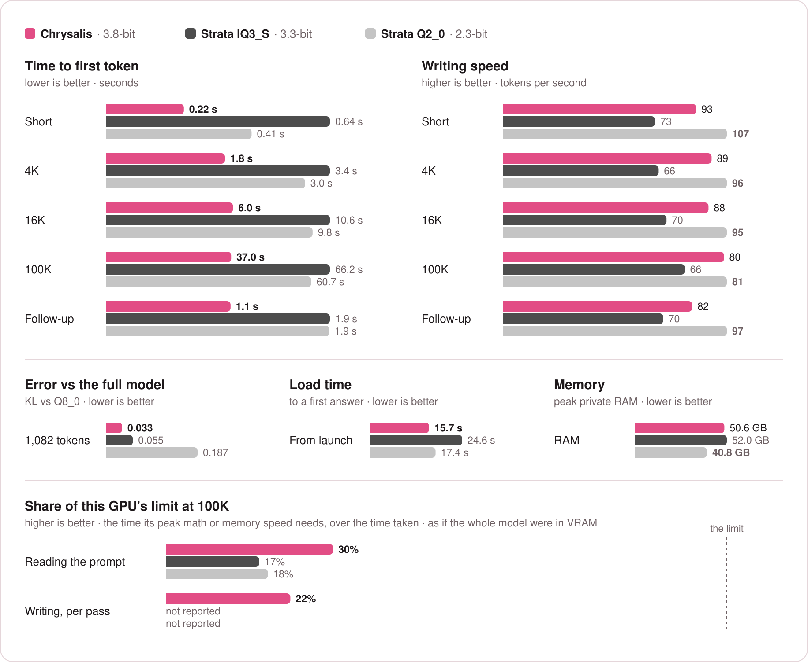
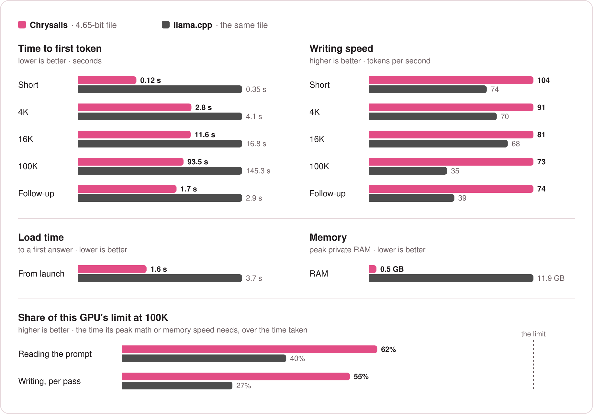
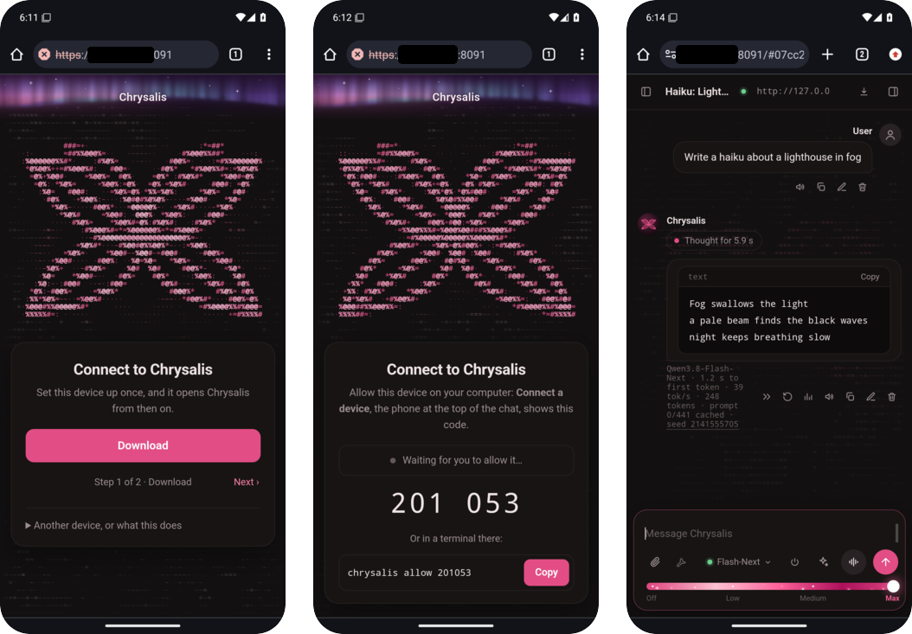

<p align="center"></p>

<h1 align="center">Chrysalis</h1>

<p align="center">A local inference engine, API server and web chat for Qwen3.8-27B and Qwen3.8-Flash-Next on an AMD Radeon RX 7900 XTX.</p>

<p align="center">
  <a href="LICENSE"></a>
  <a href="https://x.com/michaeldinelle"></a>
  <a href="https://ko-fi.com/michaeldinelle"></a>
</p>

<p align="center"><br>
<sub>A voxel pagoda garden that Qwen3.8-Flash-Next wrote from one prompt in about two minutes, in Chrysalis on an RX 7900 XTX.</sub></p>

## Chrysalis vs Strata

Qwen3.8-Flash-Next on one PC. Each engine runs at its best for this PC, and the same client times every request.

<p align="center"></p>

Strata's IQ3_S is the closest to Chrysalis in quality, and the best Strata's setup offers a 64 GB PC. Chrysalis beats it
on every measure here: first tokens 1.8-2.9x sooner, writing 1.2-1.3x faster, 1.7x closer to the full model and 1.6x
faster to load, in less memory. Strata's Q2_0 is its speed setting: it writes 1.0-1.2x faster than Chrysalis and needs
10 GB less memory, at 5.6 times the error, and it failed one of its own sanity checks in one of the two runs. Reading a
100K prompt, Chrysalis reaches 30% of this GPU's limit and Strata 17-18%.

<details><summary>How it was measured, and every number</summary>

RX 7900 XTX (24 GB), Ryzen 7 7800X3D, 64 GB DDR5, Linux, one engine at a time.

- **Chrysalis**: its own Flash-Next file, 3.8 bits per expert weight, 63 GB plus a 54 GB lookup table read from disk. The
  most used experts are IQ4_XS (gate and up) with IQ4_NL (down), the others Q3_K or Q2_K with IQ4_NL down, and attention
  and the remaining layers Q6_K and Q8_0.
- **Strata 0.2.6** (engine 0.1.50, its `linux-x86_64-hip-rx7900` build) with its RX 7900 switches on: the hipBLASLt
  tuning table, prompt attention on the matrix cores and the exact long-prompt scorer. Its own `strata tune auto` found
  nothing faster. IQ3_S is 3.3 bits (55 GB plus a 29 GB table) and Q2_0 2.3 bits (38 GB plus 29 GB).
- Short, 4K and 16K are Strata's standard benchmark, run through its own client code: its fixed prompts, Qwen's thinking
  defaults, 512-token answers and its 12 sanity checks. 100K is the same kind of records at 98,878 tokens, and the
  follow-up adds about 1,100 tokens to that chat. Each engine ran all of it twice: medians over 6 rounds, and over 10
  trials at 100K.
- KL is against Q8_0 over the same 1,082 tokens of prose, a technical explanation and Python. Chrysalis ran one token at
  a time, as it writes, with its experts moving as they do in use; Strata's files ran in llama.cpp.
- Memory is the peak private RAM of each server. File pages, which the kernel can drop at any time, are not counted.
- **Share of this GPU's limit**: the time the card's peak FP16 matrix rate needs for the prompt's math, or its memory
  bandwidth for the weights a pass reads, over the time taken. [bench/limits.py](bench/limits.py) reads both from the
  driver and the work from the model file. For Flash-Next it counts the whole model as if it were in VRAM, which it
  can't be on this card, and Strata doesn't report how many tokens each of its passes writes.

| | Chrysalis, 3.8-bit | Strata IQ3_S, 3.3-bit | Strata Q2_0, 2.3-bit |
| --- | ---: | ---: | ---: |
| First token, short prompt | **0.22 s** | 0.64 s | 0.41 s |
| First token, 4K prompt | **1.8 s** | 3.4 s | 3.0 s |
| First token, 16K prompt | **6.0 s** | 10.6 s | 9.8 s |
| First token, 100K prompt | **37.0 s** | 66.2 s | 60.7 s |
| First token, follow-up in the 100K chat | **1.1 s** | 1.9 s | 1.9 s |
| Writing, short prompt | 92.6 tok/s | 72.9 tok/s | **107.3 tok/s** |
| Writing, 4K prompt | 89.1 tok/s | 66.5 tok/s | **95.6 tok/s** |
| Writing, 16K prompt | 87.6 tok/s | 69.7 tok/s | **95.4 tok/s** |
| Writing, 100K prompt | 80.0 tok/s | 65.8 tok/s | **81.0 tok/s** |
| Writing, follow-up in the 100K chat | 82.3 tok/s | 69.7 tok/s | **97.4 tok/s** |
| Error vs Q8_0, mean KL over 1,082 tokens | **0.033** | 0.055 | 0.187 |
| Load time, to a first answer | **15.7 s** | 24.6 s | 17.4 s |
| Peak private RAM | 50.6 GB | 52.0 GB | **40.8 GB** |
| Share of this GPU's limit, reading 100K | **30%** | 17% | 18% |
| Share of this GPU's limit, writing at 100K | **22%** | not reported | not reported |

</details>

## Chrysalis vs llama.cpp, Qwen3.8-27B

The same file in Chrysalis and in llama.cpp, on the same GPU.

<p align="center"></p>

Chrysalis reads prompts 1.4-2.8x sooner, writes 1.2-2.1x faster, starts 2.4x sooner and keeps 11 GB less in RAM. At
100K it reaches 62% of this GPU's limit reading the prompt and 55% writing, llama.cpp 40% and 27%.

<details><summary>How it was measured, and every number</summary>

- **The file**: Chrysalis's own 27B file, one file for both engines: 16 GB, entirely in VRAM, 4.65 bits per weight on
  average because each tensor has its own type, IQ4_XS for most and Q6_K or Q8_0 for the most sensitive.
- **llama.cpp** commit 9c2e0e4 (October 7, 2026) built for HIP, at its best on this card: every layer on the GPU, flash
  attention with an 8-bit KV cache (its 16-bit decode kernel for this model's 256-wide heads isn't built for this card),
  MTP speculative decoding with 3 drafts as Chrysalis uses, one slot, a 131K context, and prompt batches of 2,048 tokens
  (4,096 was 3% faster on prompts but doesn't fit beside that context).
- The same benchmark and PC as above. Chrysalis ran it twice and llama.cpp once; medians over every round, and over 10
  and 5 trials at 100K. Sanity checks: Chrysalis 24/24, llama.cpp 10/12 (its misses were answers that were not strict
  JSON).
- **Share of this GPU's limit**: as above, with each engine's tokens per pass from its own log.

| | Chrysalis, 4.65-bit file | llama.cpp, the same file |
| --- | ---: | ---: |
| First token, short prompt | **0.12 s** | 0.35 s |
| First token, 4K prompt | **2.8 s** | 4.1 s |
| First token, 16K prompt | **11.6 s** | 16.8 s |
| First token, 100K prompt | **93.5 s** | 145.3 s |
| First token, follow-up in the 100K chat | **1.7 s** | 2.9 s |
| Writing, short prompt | **103.7 tok/s** | 74.3 tok/s |
| Writing, 4K prompt | **90.6 tok/s** | 70.5 tok/s |
| Writing, 16K prompt | **80.9 tok/s** | 68.3 tok/s |
| Writing, 100K prompt | **73.1 tok/s** | 34.7 tok/s |
| Writing, follow-up in the 100K chat | **74.3 tok/s** | 38.5 tok/s |
| Load time, to a first answer | **1.6 s** | 3.7 s |
| Peak private RAM | **0.5 GB** | 11.9 GB |
| Share of this GPU's limit, reading 100K | **62%** | 40% |
| Share of this GPU's limit, writing at 100K | **55%** | 27% |

</details>

## Editing artifacts by pointing at them

<p align="center"></p>

<sub>Artifacts render while they are written. Hovering over a part highlights it and clicking attaches it to your next
message, so "make this bright red" changes only that part. The door was filled with the paint bucket, which edits the
artifact directly without the model.</sub>

## SillyTavern character cards

<p align="center"></p>

<sub>A SillyTavern card imported by drag and drop: the character's greeting, and speech and narration formatted the way
SillyTavern formats them. In group chats each speaker has their own portrait. Seraphina is SillyTavern's sample character
(AGPL-3.0), so this one recording is under their license.</sub>

## Phones and other devices

<p align="center"></p>
<p align="center"></p>

<sub>Scan the QR code, trust this computer's certificate authority once (the page shows how for each kind of device), and
allow the code the phone shows. The chat then runs over HTTPS. The authority is only valid for addresses on your
network, and only devices you allow get past the connect page.</sub>

## Also

- **Voice mode** that hears you talk over the reply
- **Tools**, MCP servers and sub-agents
- **Claude Code** and **OpenCode**, through OpenAI and Anthropic APIs
- The same chat on **llama.cpp, Ollama, LM Studio, KoboldCpp or vLLM**
- **Qwen3.8-27B** with its full 262K context: 104 tok/s on short prompts, 73 at 100K

## Run it

With an RX 7900 XTX, XT or GRE. Linux:

```sh
curl -fsSL https://github.com/michaelDinelle/chrysalis-inference/releases/latest/download/chrysalis-linux-x86_64.tar.gz | tar -xz
chrysalis/chrysalis.sh
```

Nothing is installed outside that folder. With 64 GB of RAM, each start asks which model to run; otherwise it runs the
27B. The first start downloads the model (16 GB for the 27B, 117 GB for Flash-Next) and prints the chat's address.
Chrysalis runs in that terminal, and Ctrl+C stops it.

Your laptop and phone use it too: `chrysalis.sh --host 0.0.0.0` puts it on your network. A laptop runs the same
Chrysalis, finds yours by itself, and asks in both terminals with the same code: answer y on each, once, and its apps
use your GPU at `http://127.0.0.1:8080`, as if it were there. A phone scans the QR code, trusts Chrysalis once, and gets the chat. No RX 7900 at all? You get the chat
alone, for Ollama, LM Studio or llama.cpp.

A Mac is such a laptop: the same two lines with `chrysalis-macos-arm64.tar.gz`; after that, `chrysalis/Chrysalis.app` opens it in Terminal.

Windows: double-click [chrysalis.wsl](https://github.com/michaelDinelle/chrysalis-inference/releases/latest/download/chrysalis.wsl) (with WSL on: `wsl --install` as an administrator, once). Then Chrysalis is in the Start menu: its window is Chrysalis, asks there, and closing it stops it. On your network instead: `wsl -d Chrysalis --cd ~ -- chrysalis/chrysalis.sh --host 0.0.0.0` in PowerShell.

Docker, for the API alone (`http://localhost:8080/v1`):

```sh
docker run -d --device /dev/kfd --device /dev/dri -p 127.0.0.1:8080:8080 -v chrysalis:/models ghcr.io/michaeldinelle/chrysalis
```

## How it works

Chrysalis has its own engine for this GPU: hand-written kernels for each quantized format, MTP speculative decoding,
and a prompt cache that turns each agent turn into an append. Flash-Next's 24,576 experts are placed by how often its
replies use them: the most used in VRAM, following the conversation, and the rest in RAM, computed by the CPU. VRAM the
KV cache isn't using holds about 1,300 more experts, until a long context needs it back. Each machine's speeds are
measured once and kept, and experts move at fixed steps, so a run repeats to the bit: that is how every engine change
is checked against the last, and none may make any measure worse.

## Links

[X @michaeldinelle](https://x.com/michaeldinelle) · [Ko-fi](https://ko-fi.com/michaeldinelle) ·
[GitHub](https://github.com/michaelDinelle)

MIT licensed.
