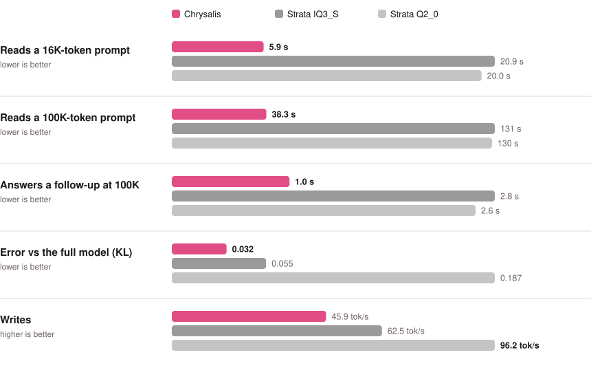
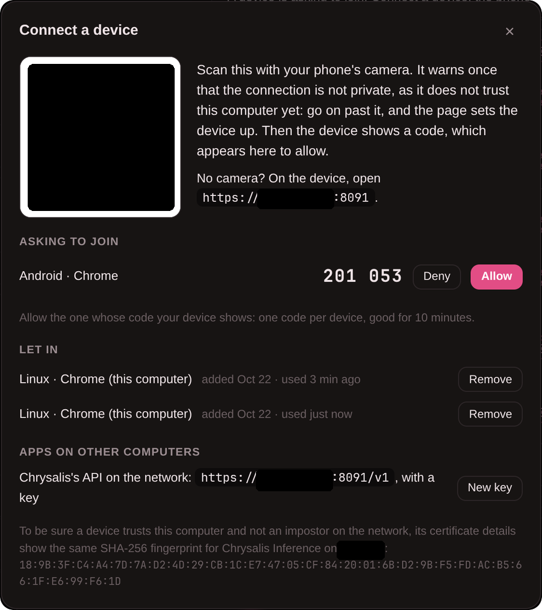

<p align="center"></p>

<h1 align="center">Chrysalis</h1>

<p align="center"><b>Qwen3.8 on one Radeon, and a chat where everything it makes stays alive.</b></p>

<p align="center">
  <a href="LICENSE"></a>
  <a href="https://x.com/michaeldinelle"></a>
  <a href="https://ko-fi.com/michaeldinelle"></a>
</p>

<p align="center"><br>
<sub>A voxel pagoda garden, one prompt, Qwen3.8-Flash-Next on an RX 7900 XTX with Chrysalis, written in about two minutes ·
<a href="docs/media/pagoda-making-of.webp">watch one being written</a></sub></p>

## Chrysalis vs Strata

Same PC, same model, Strata's own benchmark prompts.

<p align="center"><picture>
  <source media="(prefers-color-scheme: dark)" srcset="docs/media/vs-strata-dark.svg">
  
</picture></p>

<sub>RX 7900 XTX, Ryzen 7 7800X3D, 64 GB. Qwen3.8-Flash-Next. Strata 0.2.2 as its setup installs it, at its best quality
(IQ3_S) and its fastest (Q2_0). Every request timed by the same client. How, and every number: [docs/BENCHMARKS.md](docs/BENCHMARKS.md).</sub>

## Point at it. Say what to change.

<p align="center"></p>

<sub>Drawn as it's written. Hover a part and it glows; click and "make this bright red" means that part, and only it
changes. The gold door is the paint bucket: no model, no wait.</sub>

## Bring your characters

<p align="center"></p>

<sub>A SillyTavern card dropped in: her greeting, speech and narration set as SillyTavern sets them, her card a click away.
Groups write the scene together, each speaker with their own face. Seraphina is SillyTavern's sample character
(AGPL-3.0), so this one recording is under their license.</sub>

## On your phone, over real HTTPS

<p align="center"></p>
<p align="center"></p>

<sub>Scan the QR code, trust this computer once (the page walks each kind of device through it), and allow the code the
phone shows. Then it's the chat, on HTTPS the phone trusts, from a certificate authority of its own that can vouch for
nothing outside your network. Only devices you let in get past the connect page.</sub>

## And

- **Voice mode** that hears you talk over the reply
- **Tools**, MCP servers and sub-agents
- **Claude Code** and **OpenCode**, through OpenAI and Anthropic APIs
- The same chat on **llama.cpp, Ollama, LM Studio, KoboldCpp or vLLM**
- **Qwen3.8-27B** at 100+ tok/s, with its full 262K context

## Run it

You need an RX 7900 XTX (24 GB) and, for Flash-Next, 64 GB of RAM.

```sh
git clone https://github.com/michaelDinelle/chrysalis-inference && cd chrysalis-inference
make && make fn              # the two engines, against ROCm in data/rocm
(cd web && bun install)      # the chat
./chrysalis.sh install       # the `chrysalis` command and its services
chrysalis start              # API on http://127.0.0.1:8080/v1, chat on https://localhost:8081
```

Where the models come from, and everything else: [docs/DETAILS.md](docs/DETAILS.md).

## How

An engine written by hand for one GPU: its own kernels for every quantized format, MTP drafts, and prompt caching that
makes each agent turn an append. Flash-Next's 24,576 experts live where they're used: the busiest in VRAM, following
what you're doing, the rest in RAM, run by the CPU at its full memory bandwidth. [The details](docs/DETAILS.md).

## Follow along

[X @michaeldinelle](https://x.com/michaeldinelle) · [Ko-fi](https://ko-fi.com/michaeldinelle) ·
[GitHub](https://github.com/michaelDinelle)

MIT licensed.
