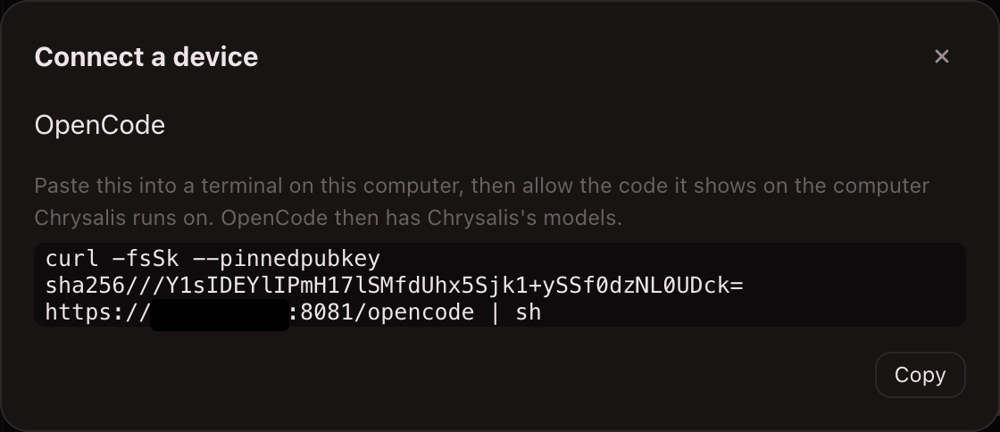
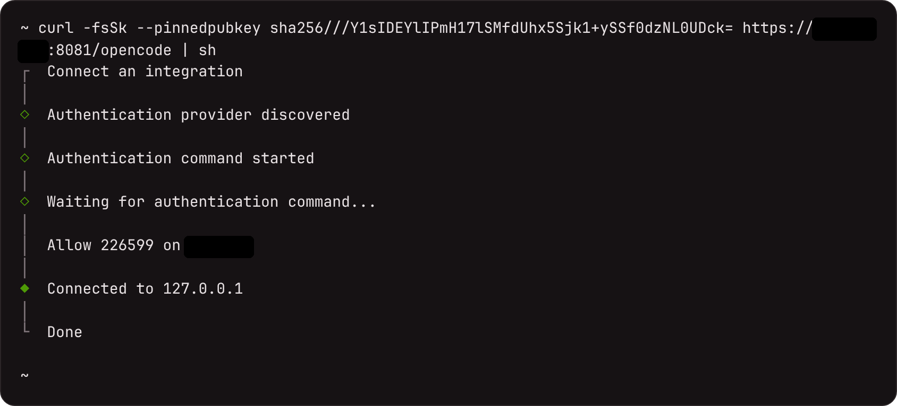
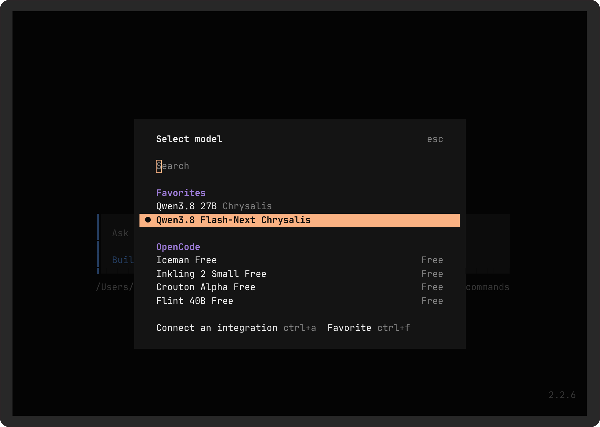
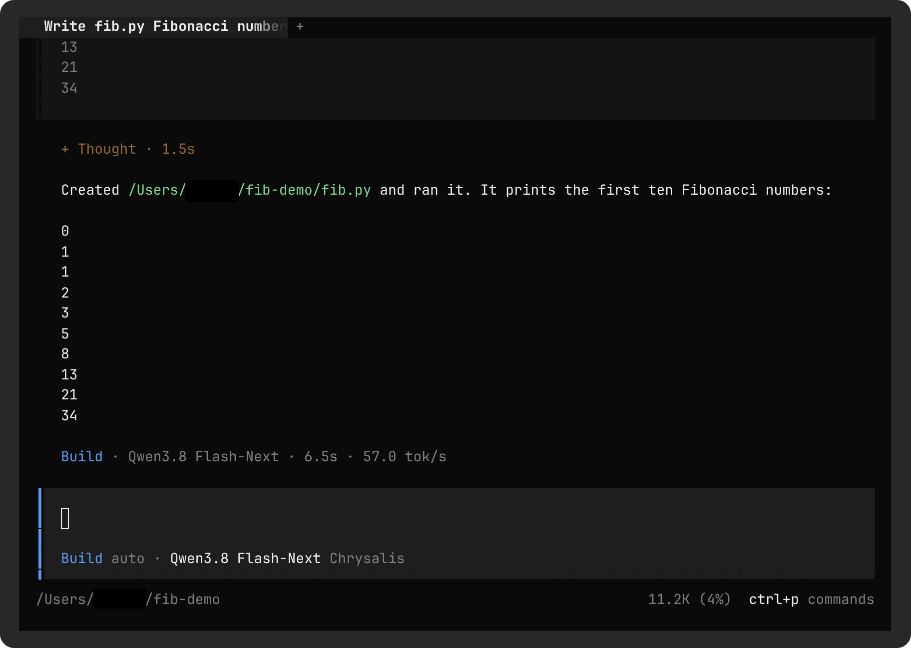

<p align="center"></p>

<h1 align="center">Chrysalis</h1>

<p align="center">A local inference engine, API server and web chat for Qwen3.8-27B and Qwen3.8-Flash-Next on an AMD Radeon RX 7900 XTX, an NVIDIA GeForce RTX or a Mac with Apple Silicon.</p>

<p align="center">
  <a href="LICENSE"></a>
  <a href="https://x.com/michaeldinelle"></a>
  <a href="https://ko-fi.com/michaeldinelle"></a>
</p>

<p align="center"><a href="https://huggingface.co/michaelDinelle/chrysalis"></a></p>

<p align="center"><br>
<sub>A voxel pagoda garden written by Qwen3.8-Flash-Next in Chrysalis.</sub></p>

## Qwen3.8-Flash-Next: Chrysalis vs Strata

<p align="center"></p>

On the RX 7900, Chrysalis beats Strata's IQ3_S, its closest file in quality, on every measure. Strata's Q2_0 writes faster and
uses less memory, with over five times the error. On the RTX 5070, Chrysalis is closer to the full model and loads faster, and
Strata writes faster.

<details><summary>How it was measured</summary>

- **Machines**: an RX 7900 XTX (24 GB) with a Ryzen 7 7800X3D and 64 GB of DDR5, an RTX 5070 (12 GB) with a Core
  i5-11600KF and 64 GB of RAM, rented on vast.ai, both on Linux, and an M4 Max Mac Studio with 36 GB on macOS 27.2. One
  engine ran at a time, and one client timed every request.
- **Chrysalis**: its own file, 3.8 bits per expert weight, 63 GB plus a 54 GB lookup table read from disk.
- **Strata**: IQ3_S (3.3 bits) and Q2_0 (2.3 bits). 0.2.6 on the RX 7900 with its RX 7900 switches on, and 0.2.9 on the
  RTX 5070 with the setup its installer writes. Strata doesn't run on a Mac.
- **Prompts**: short, 4K and 16K are Strata's standard benchmark, run through its own client code with 512-token answers.
  100K is the same kind of records at 98,878 tokens. The follow-up adds about 1,100 tokens to that chat.
- **Rounds**: medians over two rounds on each PC and one on the Mac, run from October 30 to November 1, 2026.
- **Error**: KL against Q8_0 over 1,082 tokens of prose, a technical explanation and Python. Strata's files ran in
  llama.cpp.
- **Memory**: the peak private RAM of each server, pinned buffers included, and the peak footprint on the Mac.
- **Share of each GPU's limit**: computed by [bench/limits.py](bench/limits.py), counting the whole model as if it were in
  VRAM. Strata doesn't report the tokens each of its passes writes.

</details>

## Qwen3.8-27B: Chrysalis vs llama.cpp and MLX

<p align="center"></p>

<details><summary>How it was measured</summary>

- **Machines and prompts**: the same as above. The benchmark's thinking budget of 0 is left out, because Strata and
  llama.cpp read it differently.
- **The file**: Chrysalis and llama.cpp ran the same 16 GB file, 4.65 bits per weight on average.
- **llama.cpp**: commit 9c2e0e4 for HIP and CUDA, and Homebrew's build 11669 on the Mac. Flash attention, MTP with 3
  drafts, one slot and a 131K context. The RX 7900 ran every layer on the GPU with an 8-bit KV cache and prompt batches of
  2,048. The RTX 5070 ran the 21 of 66 layers its own fit chose.
- **MLX**: 0.32.4 with mlx-lm 0.32.2 and mlx-community's 4-bit model, through `mlx_lm.server`, which has no MTP for this
  model. The 100K prompt ran with prefill steps of 512, because the default ran out of memory. The follow-up ran out of
  memory at 512 too.
- **Rounds**: medians over two rounds for Chrysalis and one for llama.cpp and MLX, run from October 26 to November 1, 2026.
- **Error and memory**: as above. Chrysalis's footprint on the Mac includes its conversation snapshots.
- **Share of each GPU's limit**: as above, with each engine's tokens per pass from its log. The Mac uses Apple's published
  bandwidth and its GPU's FP16 rate.

</details>

## Editing artifacts by pointing at them

<p align="center"></p>

<sub>Artifacts render as they are written. Hover over a part to highlight it, click to attach it to your next message, and
ask for a change. The paint bucket edits the artifact by hand.</sub>

## SillyTavern character cards

<p align="center"></p>

<sub>Drag in a SillyTavern card to import it. Speech and narration look the way they do in SillyTavern, and each speaker in a
group chat has a portrait. Seraphina is SillyTavern's sample character (AGPL-3.0), and this one recording is under their
license.</sub>

## Phones and other devices

<p align="center"></p>
<p align="center"></p>

<sub>Scan the QR code, trust this computer's certificate authority once, and allow the code the phone shows. The page shows
how to trust it on each kind of device. The chat runs over HTTPS, and the authority is valid only on your network.</sub>

## Coding on another computer

Run Chrysalis on one computer and code on another with [OpenCode](https://opencode.ai). Start Chrysalis with
`chrysalis.sh --host 0.0.0.0`.

<p align="center"></p>

<sub>Open Chrysalis in that computer's browser, allow its code, and copy the line under Connect a device. Over SSH, copy the
same line from Chrysalis's terminal.</sub>

<p align="center"></p>

<sub>Paste the line into a terminal, in WSL on Windows, and allow the code it shows. If OpenCode is open, it asks you to close
it first.</sub>

<p align="center"> </p>

<sub>Press `ctrl+x m` and pick a model. The line adds both to your favorites. OpenCode retries while Chrysalis is off. To take
a computer's access away, use Remove under Connect a device.</sub>

The line pins this computer's key, and only computers you allow get in. OpenCode connects over HTTPS and trusts Chrysalis's
authority for local names only.

On a Mac, the line also adds a launchd job that forwards a local port to Chrysalis through Apple's `nc`, with HTTPS end to
end. macOS cuts a background program off the network when the app that started it quits, and this keeps OpenCode connected.

## Also

- **Voice mode** you can interrupt by talking
- **Tools**, MCP servers and sub-agents
- **Claude Code** and **OpenCode**, through OpenAI and Anthropic APIs
- The same chat on **llama.cpp, Ollama, LM Studio, KoboldCpp or vLLM**
- **Qwen3.8-27B** with its full 262K context
- **Apple Silicon** with 32 GB or more runs both models
- **NVIDIA** RTX 30 series and newer run both models

## Run it

On an RX 7900 XTX, XT or GRE with Linux:

```sh
curl -fsSL https://github.com/michaelDinelle/chrysalis-inference/releases/latest/download/chrysalis-linux-x86_64.tar.gz | tar -xz
chrysalis/chrysalis.sh
```

Everything stays in that folder. With 64 GB of RAM, each start asks which model to run. With less, it runs the 27B. The first
start downloads the model from [Hugging Face](https://huggingface.co/michaelDinelle/chrysalis) (16 GB for the 27B, 117 GB for
Flash-Next) and prints the chat's address. Press Ctrl+C in that terminal to stop it.

**On your network**: run `chrysalis.sh --host 0.0.0.0`. Run the same Chrysalis on a laptop and it finds yours. Answer y in both
terminals, once, and the laptop's apps use your GPU at `http://127.0.0.1:8080`. On a computer with no supported GPU, you get
the chat alone, for Ollama, LM Studio or llama.cpp.

**Mac**: Apple Silicon with 32 GB or more runs the models from a clone of this repository. The first `./chrysalis.sh` gets
Python and Bun and builds the Metal engines with Xcode's Metal compiler. For a laptop's chat alone, use the same two lines with
`chrysalis-macos-arm64.tar.gz`, then open `chrysalis/Chrysalis.app`.

**NVIDIA**: an RTX 30 series or newer on Linux, with NVIDIA's driver and CUDA toolkit, runs the models from a clone. The first
`./chrysalis.sh` builds the CUDA engines.

**Windows**: run `wsl --install` as an administrator, once, then double-click
[chrysalis.wsl](https://github.com/michaelDinelle/chrysalis-inference/releases/latest/download/chrysalis.wsl). Chrysalis is
then in the Start menu, and closing its window stops it. To put it on your network, run
`wsl -d Chrysalis --cd ~ -- chrysalis/chrysalis.sh --host 0.0.0.0` in PowerShell.

**Docker**, for the API alone at `http://localhost:8080/v1`:

```sh
docker run -d --device /dev/kfd --device /dev/dri -p 127.0.0.1:8080:8080 -v chrysalis:/models ghcr.io/michaeldinelle/chrysalis
```

## How it works

Chrysalis has its own engines for AMD, NVIDIA and Apple GPUs, with hand-written kernels for each quantized format, MTP
speculative decoding and a prompt cache for agent turns.

Flash-Next keeps its most used experts in VRAM. The CPU runs the rest from RAM. On a Mac it keeps them in memory and reads the
others from the SSD.

A small card holds what it can of the 27B and reads the other layers from pinned RAM as it writes.

Runs repeat to the bit, and each engine change is checked against the last on every machine.

## Links

[Hugging Face](https://huggingface.co/michaelDinelle/chrysalis) · [X @michaeldinelle](https://x.com/michaeldinelle) ·
[Ko-fi](https://ko-fi.com/michaeldinelle) · [GitHub](https://github.com/michaelDinelle)

MIT licensed.
