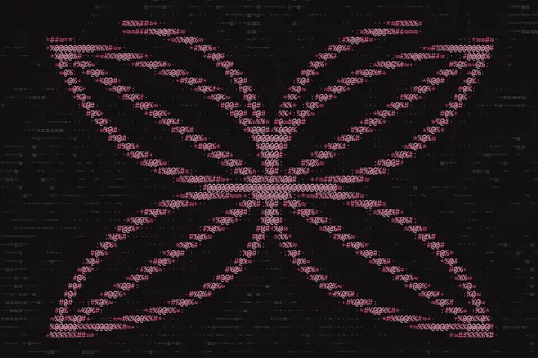
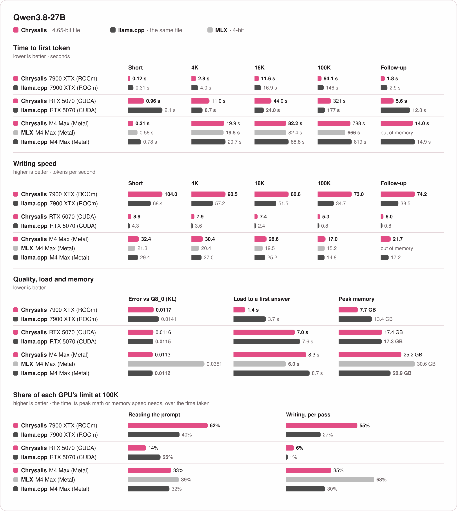
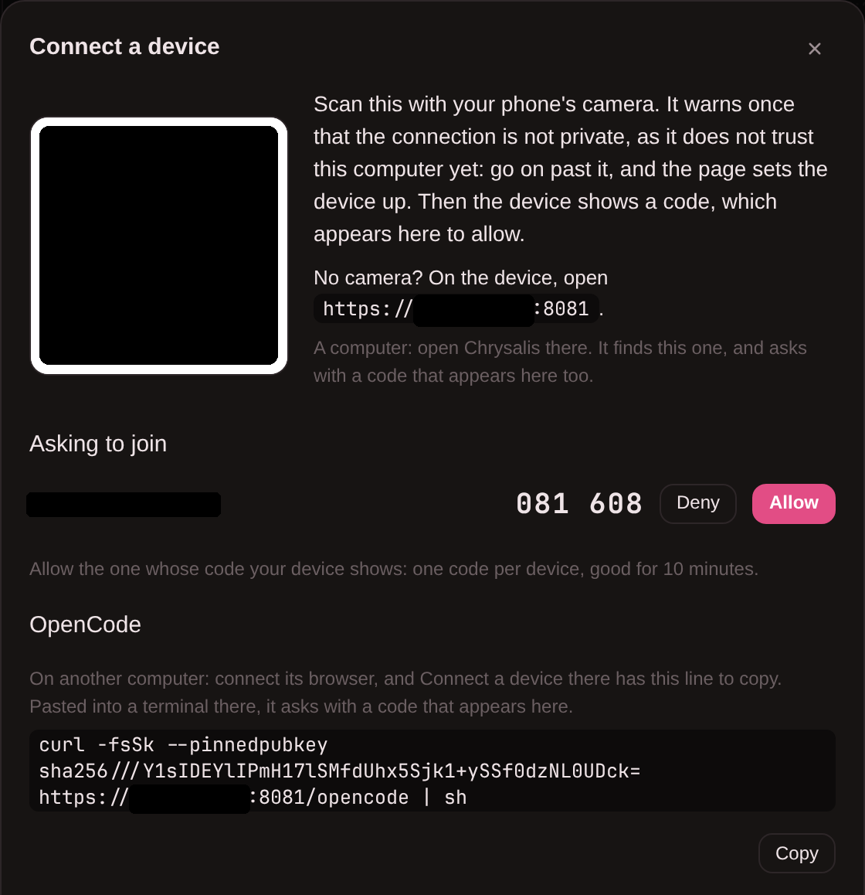

<p align="center"></p>

<h1 align="center">Chrysalis</h1>

<p align="center">A local inference engine, API server and web chat for Qwen3.8-27B and Qwen3.8-Flash-Next on an AMD Radeon RX 7900 XTX, an NVIDIA GeForce RTX or a Mac with Apple Silicon.</p>

<p align="center">
  <a href="LICENSE"></a>
  <a href="https://x.com/michaeldinelle"></a>
  <a href="https://ko-fi.com/michaeldinelle"></a>
</p>

<p align="center"><br>
<sub>A voxel pagoda garden that Qwen3.8-Flash-Next wrote from one prompt in about two minutes, in Chrysalis on an RX 7900 XTX.</sub></p>

## Qwen3.8-Flash-Next: Chrysalis vs Strata

Qwen3.8-Flash-Next on each GPU Chrysalis runs on. Each engine runs at its best for each machine, and the same client
times every request.

<p align="center"></p>

On the RX 7900, Strata's IQ3_S is the closest to Chrysalis in quality, and Chrysalis beats it on every measure:
first tokens 1.8-2.8x sooner, writing 1.2-1.3x faster, 1.6x closer to the full model and 1.5x faster to load, in less
memory. Strata's Q2_0 is its speed setting: it writes up to 1.2x faster than Chrysalis and needs 9 GB less memory, at
5.5 times the error. On the 12 GB RTX 5070, Chrysalis answers a short prompt or a follow-up 1.5-1.6x sooner than
IQ3_S, loads 1.4x faster and stays 1.7x closer to the full model, but Strata writes faster there, IQ3_S 1.6-2.0x and
Q2_0 3.0-3.6x, and reads 4K to 100K prompts sooner: most of Flash-Next's experts don't fit in 12 GB, and Chrysalis
runs them on a 6-core CPU and across PCIe. On the M4 Max, where Strata doesn't run, Chrysalis writes 8-10 tokens a
second in 36 GB, reading the experts it doesn't keep from the SSD.

<details><summary>How it was measured, and every number</summary>

- **RX 7900 XTX** (24 GB), Ryzen 7 7800X3D, 64 GB DDR5, Linux. **RTX 5070** (12 GB, PCIe 4.0 x16), Core i5-11600KF (6
  cores), 64 GB of RAM with 60 GiB for its container, Linux, NVIDIA driver 615.71.09, rented on vast.ai. **M4 Max** Mac
  Studio with a 32-core GPU, 36 GB, macOS 27.2. One engine at a time.
- **Chrysalis**: its own Flash-Next file, 3.8 bits per expert weight, 63 GB plus a 54 GB lookup table read from disk.
  The most used experts are IQ4_XS (gate and up) with IQ4_NL (down), the others Q3_K or Q2_K with IQ4_NL down, and
  attention and the remaining layers Q6_K and Q8_0. On the 5070, the experts VRAM can't hold run from RAM, on the CPU
  and over PCIe; on the Mac, Chrysalis keeps the experts its replies use most in memory and reads the others from the
  SSD, with its context raised to 131,072 tokens for the 100K prompt.
- **Strata**: 0.2.6 on the RX 7900 (engine 0.1.50, its `linux-x86_64-hip-rx7900` build) with its RX 7900 switches on:
  the hipBLASLt tuning table, prompt attention on the matrix cores and the exact long-prompt scorer; its own
  `strata tune auto` found nothing faster. 0.2.9 on the RTX 5070 (terminal 0.1.55, its CUDA build), with the setup its
  installer writes for that PC: experts cached in VRAM, its own prompt split, 4 MTP drafts and an 8-bit KV cache. IQ3_S
  is 3.3 bits (55 GB plus a 29 GB table) and Q2_0 2.3 bits (38 GB plus 29 GB), the same files on both PCs. Strata
  doesn't run on a Mac.
- Short, 4K and 16K are Strata's standard benchmark, run through its own client code: its fixed prompts, Qwen's thinking
  defaults, 512-token answers and its 12 sanity checks. 100K is the same kind of records at 98,878 tokens, and the
  follow-up adds about 1,100 tokens to that chat. Each engine ran all of it twice on each PC and Chrysalis once on the
  Mac: medians over every round. Strata ran on October 30 on the RX 7900 and October 31 on the RTX 5070, Chrysalis on
  November 1 on both PCs and on October 30 on the Mac.
- KL is against Q8_0 over the same 1,082 tokens of prose, a technical explanation and Python. Chrysalis ran one token at
  a time, as it writes, with its experts moving as they do in use; Strata's files ran in llama.cpp.
- Memory is the peak private RAM of each server, pinned buffers included, and on the Mac its peak footprint. File
  pages, which the kernel can drop at any time, are not counted.
- **Share of each GPU's limit**: the time the card's peak FP16 matrix rate needs for the prompt's math, or its memory
  bandwidth for the weights a pass reads, over the time taken. [bench/limits.py](bench/limits.py) reads both from the
  driver and the work from the model file. For Flash-Next it counts the whole model as if it were in VRAM, which it can't
  be on any of these, and Strata doesn't report how many tokens each of its passes writes.

**RX 7900 XTX**

| | Chrysalis 7900 XTX (ROCm) | Strata IQ3_S 7900 XTX (ROCm) | Strata Q2_0 7900 XTX (ROCm) |
| --- | ---: | ---: | ---: |
| First token, short prompt | **0.24 s** | 0.67 s | 0.37 s |
| First token, 4K prompt | **1.8 s** | 3.4 s | 3.0 s |
| First token, 16K prompt | **5.9 s** | 10.7 s | 9.8 s |
| First token, 100K prompt | **37.7 s** | 66.1 s | 60.9 s |
| First token, follow-up in the 100K chat | **1.1 s** | 2.1 s | 1.9 s |
| Writing, short prompt | 91.8 tok/s | 72.4 tok/s | **110.0 tok/s** |
| Writing, 4K prompt | 91.2 tok/s | 67.6 tok/s | **94.8 tok/s** |
| Writing, 16K prompt | 86.2 tok/s | 72.5 tok/s | **96.3 tok/s** |
| Writing, 100K prompt | **82.3 tok/s** | 66.5 tok/s | 82.2 tok/s |
| Writing, follow-up in the 100K chat | 89.6 tok/s | 71.7 tok/s | **96.6 tok/s** |
| Error vs Q8_0, mean KL over 1,082 tokens | **0.0339** | 0.0550 | 0.187 |
| Load time, to a first answer | **14.8 s** | 21.6 s | 16.2 s |
| Peak memory | 54.2 GB | 55.3 GB | **45.1 GB** |
| Share of the GPU's limit, reading 100K | **29%** | 17% | 18% |
| Share of the GPU's limit, writing at 100K | 24% | not reported | not reported |

**RTX 5070**

| | Chrysalis RTX 5070 (CUDA) | Strata IQ3_S RTX 5070 (CUDA) | Strata Q2_0 RTX 5070 (CUDA) |
| --- | ---: | ---: | ---: |
| First token, short prompt | **0.52 s** | 0.84 s | 0.70 s |
| First token, 4K prompt | 2.7 s | 2.3 s | **1.6 s** |
| First token, 16K prompt | 8.3 s | 7.9 s | **5.2 s** |
| First token, 100K prompt | 52.6 s | 46.5 s | **33.1 s** |
| First token, follow-up in the 100K chat | **1.9 s** | 2.8 s | 2.2 s |
| Writing, short prompt | 30.3 tok/s | 54.0 tok/s | **102.0 tok/s** |
| Writing, 4K prompt | 32.2 tok/s | 52.3 tok/s | **100.8 tok/s** |
| Writing, 16K prompt | 30.3 tok/s | 54.8 tok/s | **91.1 tok/s** |
| Writing, 100K prompt | 28.3 tok/s | 56.1 tok/s | **96.2 tok/s** |
| Writing, follow-up in the 100K chat | 27.2 tok/s | 54.9 tok/s | **97.1 tok/s** |
| Error vs Q8_0, mean KL over 1,082 tokens | **0.0315** | 0.0550 | 0.187 |
| Load time, to a first answer | **26.4 s** | 38.2 s | 28.1 s |
| Peak memory | 59.4 GB | 56.6 GB | **44.5 GB** |
| Share of the GPU's limit, reading 100K | 16% | 18% | **25%** |
| Share of the GPU's limit, writing at 100K | 11% | not reported | not reported |

**M4 Max**

| | Chrysalis M4 Max (Metal) |
| --- | ---: |
| First token, short prompt | 3.0 s |
| First token, 4K prompt | 14.3 s |
| First token, 16K prompt | 39.6 s |
| First token, 100K prompt | 254 s |
| First token, follow-up in the 100K chat | 11.7 s |
| Writing, short prompt | 9.3 tok/s |
| Writing, 4K prompt | 9.6 tok/s |
| Writing, 16K prompt | 8.9 tok/s |
| Writing, 100K prompt | 8.2 tok/s |
| Writing, follow-up in the 100K chat | 9.7 tok/s |
| Error vs Q8_0, mean KL over 1,082 tokens | 0.0351 |
| Load time, to a first answer | 6.9 s |
| Peak memory | 32.1 GB |
| Share of the GPU's limit, reading 100K | 20% |
| Share of the GPU's limit, writing at 100K | 6% |

</details>

## Qwen3.8-27B: Chrysalis vs llama.cpp and MLX

The same file in Chrysalis and in llama.cpp on each GPU, and MLX's 4-bit model on the Mac.

<p align="center"></p>

On the RX 7900, Chrysalis reads prompts 1.4-2.6x sooner than llama.cpp with the same file, writes 1.5-2.1x faster,
starts 2.7x sooner and keeps 6 GB less in RAM; at 100K it reaches 62% of the GPU's limit reading the prompt and 55%
writing, llama.cpp 40% and 27%. On the 12 GB RTX 5070, which holds neither engine's whole file, Chrysalis writes
2.0-7.2x faster than llama.cpp, 5.3 tokens a second at 100K to its 0.8, and answers a short prompt or a follow-up
2.2-2.3x sooner, but llama.cpp reads 4K to 100K prompts 1.6-1.8x sooner there. On the M4 Max, Chrysalis writes 1.5x
faster than MLX up to 16K and 1.1x at 100K, 1.1-1.3x faster than llama.cpp, and answers a short prompt 1.8x sooner
than MLX and 2.6x sooner than llama.cpp. Up to 16K the three read prompts at about the same speed; at 100K MLX reads
1.2x faster than the other two, then runs out of GPU memory on the follow-up in that chat.

<details><summary>How it was measured, and every number</summary>

- The same PCs and benchmark as above, its thinking budget of 0 left out: Strata's requests ask for a thinking budget of
  0, which Strata reads as no cap and llama.cpp as no thinking at all, so every engine thinks as Strata's does.
- **The file**: Chrysalis's own 27B file, one file for every engine but MLX: 16 GB, 4.65 bits per weight on average
  because each tensor has its own type, IQ4_XS for most and Q6_K or Q8_0 for the most sensitive. On the RX 7900 and the
  Mac it is entirely in GPU memory. On the 12 GB RTX 5070, Chrysalis keeps the layers that don't fit in pinned RAM, read
  across PCIe as it writes, and lends them the VRAM its KV cache isn't using until a context needs it.
- **llama.cpp**: commit 9c2e0e4 (October 7, 2026) built for HIP and for CUDA, and Homebrew's build 11669 on the Mac, each
  at its best: flash attention, MTP speculative decoding with 3 drafts as Chrysalis uses, one slot, a 131K context. On
  the RX 7900, every layer on the GPU with an 8-bit KV cache (its 16-bit decode kernel for this model's 256-wide heads
  isn't built for that card) and prompt batches of 2,048 tokens; on the RTX 5070, the layers its own fit puts on the GPU
  (21 of 66), the same KV cache and batches; on the Mac, every layer on the GPU.
- **MLX** 0.32.4 with mlx-lm 0.32.2 and mlx-community's 4-bit Qwen3.8-27B (4.5 bits per weight with its scales), through
  `mlx_lm.server`, which has no MTP for this model. Its 100K prompt runs out of GPU memory with the default prefill steps
  of 2,048, so that case ran with steps of 512; its follow-up re-read the whole chat and ran out of memory even then.
- Chrysalis ran the benchmark twice on each machine, llama.cpp and MLX once; medians over every round. MLX and llama.cpp
  ran on the Mac on October 26, Chrysalis on the RTX 5070 on November 1, the rest on October 30 and 31, with the same
  versions and files.
- KL and memory as above. Chrysalis's footprint on the Mac holds snapshots of the conversation, which a follow-up reads
  back instead of the prompt.
- **Share of each GPU's limit**: as above, with each engine's tokens per pass from its own log, and on the Mac Apple's
  published bandwidth for this chip and its GPU's FP16 rate, which counts the packed half-precision math an M4 runs at
  twice its FP32 rate.

**RX 7900 XTX**

| | Chrysalis 7900 XTX (ROCm) | llama.cpp 7900 XTX (ROCm) |
| --- | ---: | ---: |
| First token, short prompt | **0.12 s** | 0.31 s |
| First token, 4K prompt | **2.8 s** | 4.0 s |
| First token, 16K prompt | **11.6 s** | 16.9 s |
| First token, 100K prompt | **94.1 s** | 146 s |
| First token, follow-up in the 100K chat | **1.8 s** | 2.9 s |
| Writing, short prompt | **104.0 tok/s** | 68.4 tok/s |
| Writing, 4K prompt | **90.5 tok/s** | 57.2 tok/s |
| Writing, 16K prompt | **80.8 tok/s** | 51.5 tok/s |
| Writing, 100K prompt | **73.0 tok/s** | 34.7 tok/s |
| Writing, follow-up in the 100K chat | **74.2 tok/s** | 38.5 tok/s |
| Error vs Q8_0, mean KL over 1,082 tokens | **0.0117** | 0.0141 |
| Load time, to a first answer | **1.4 s** | 3.7 s |
| Peak memory | **7.7 GB** | 13.4 GB |
| Share of the GPU's limit, reading 100K | **62%** | 40% |
| Share of the GPU's limit, writing at 100K | **55%** | 27% |

**RTX 5070**

| | Chrysalis RTX 5070 (CUDA) | llama.cpp RTX 5070 (CUDA) |
| --- | ---: | ---: |
| First token, short prompt | **0.96 s** | 2.1 s |
| First token, 4K prompt | 11.0 s | **6.7 s** |
| First token, 16K prompt | 44.0 s | **24.0 s** |
| First token, 100K prompt | 321 s | **177 s** |
| First token, follow-up in the 100K chat | **5.6 s** | 12.8 s |
| Writing, short prompt | **8.9 tok/s** | 4.3 tok/s |
| Writing, 4K prompt | **7.9 tok/s** | 3.6 tok/s |
| Writing, 16K prompt | **7.4 tok/s** | 2.4 tok/s |
| Writing, 100K prompt | **5.3 tok/s** | 0.8 tok/s |
| Writing, follow-up in the 100K chat | **6.0 tok/s** | 0.8 tok/s |
| Error vs Q8_0, mean KL over 1,082 tokens | 0.0116 | **0.0115** |
| Load time, to a first answer | **7.0 s** | 7.6 s |
| Peak memory | 17.4 GB | **17.3 GB** |
| Share of the GPU's limit, reading 100K | 14% | **25%** |
| Share of the GPU's limit, writing at 100K | **6%** | 1% |

**M4 Max**

| | Chrysalis M4 Max (Metal) | MLX M4 Max (Metal) | llama.cpp M4 Max (Metal) |
| --- | ---: | ---: | ---: |
| First token, short prompt | **0.31 s** | 0.56 s | 0.78 s |
| First token, 4K prompt | 19.9 s | **19.5 s** | 20.7 s |
| First token, 16K prompt | **82.2 s** | 82.4 s | 88.8 s |
| First token, 100K prompt | 788 s | **666 s** | 819 s |
| First token, follow-up in the 100K chat | **14.0 s** | out of memory | 14.9 s |
| Writing, short prompt | **32.4 tok/s** | 21.3 tok/s | 29.4 tok/s |
| Writing, 4K prompt | **30.4 tok/s** | 20.4 tok/s | 27.0 tok/s |
| Writing, 16K prompt | **28.6 tok/s** | 19.5 tok/s | 25.2 tok/s |
| Writing, 100K prompt | **17.0 tok/s** | 15.2 tok/s | 14.8 tok/s |
| Writing, follow-up in the 100K chat | **21.7 tok/s** | out of memory | 17.2 tok/s |
| Error vs Q8_0, mean KL over 1,082 tokens | 0.0113 | 0.0351 | **0.0112** |
| Load time, to a first answer | 8.3 s | **6.0 s** | 8.7 s |
| Peak memory | 25.2 GB | 30.6 GB | **20.9 GB** |
| Share of the GPU's limit, reading 100K | 33% | **39%** | 32% |
| Share of the GPU's limit, writing at 100K | 35% | **68%** | 30% |

</details>

## Editing artifacts by pointing at them

<p align="center"></p>

<sub>Artifacts render while they are written. Hovering over a part highlights it and clicking attaches it to your next
message, so "make this bright red" changes only that part. The door was filled with the paint bucket, which edits the
artifact directly without the model.</sub>

## SillyTavern character cards

<p align="center"></p>

<sub>A SillyTavern card imported by drag and drop: the character's greeting, and speech and narration formatted the way
SillyTavern formats them. In group chats each speaker has their own portrait. Seraphina is SillyTavern's sample character
(AGPL-3.0), so this one recording is under their license.</sub>

## Phones and other devices

<p align="center"></p>
<p align="center"></p>

<sub>Scan the QR code, trust this computer's certificate authority once (the page shows how for each kind of device), and
allow the code the phone shows. The chat then runs over HTTPS. The authority is only valid for addresses on your
network, and only devices you allow get past the connect page.</sub>

## Also

- **Voice mode** that hears you talk over the reply
- **Tools**, MCP servers and sub-agents
- **Claude Code** and **OpenCode**, through OpenAI and Anthropic APIs
- The same chat on **llama.cpp, Ollama, LM Studio, KoboldCpp or vLLM**
- **Qwen3.8-27B** with its full 262K context: 104 tok/s on short prompts, 73 at 100K
- **Apple Silicon**: both models on a Mac with 32 GB or more, on Metal kernels written for its GPU; on an M4 Max the 27B
  writes 1.5x faster than MLX
- **NVIDIA**: both models on an RTX 30 series or newer, on CUDA kernels; on a 12 GB RTX 5070 the 27B writes 2-7x faster
  than llama.cpp

## Run it

With an RX 7900 XTX, XT or GRE. Linux:

```sh
curl -fsSL https://github.com/michaelDinelle/chrysalis-inference/releases/latest/download/chrysalis-linux-x86_64.tar.gz | tar -xz
chrysalis/chrysalis.sh
```

Nothing is installed outside that folder. With 64 GB of RAM, each start asks which model to run; otherwise it runs the
27B. The first start downloads the model (16 GB for the 27B, 117 GB for Flash-Next) and prints the chat's address.
Chrysalis runs in that terminal, and Ctrl+C stops it.

Your laptop and phone use it too: `chrysalis.sh --host 0.0.0.0` puts it on your network. A laptop runs the same
Chrysalis, finds yours by itself, and asks in both terminals with the same code: answer y on each, once, and its apps
use your GPU at `http://127.0.0.1:8080`, as if it were there. A phone scans the QR code, trusts Chrysalis once, and gets the chat. No RX 7900 at all? You get the chat
alone, for Ollama, LM Studio or llama.cpp.

A Mac with Apple Silicon and 32 GB or more runs the models itself from a clone of this repository: the first
`./chrysalis.sh` gets Python and Bun into the folder and builds the Metal engines with Xcode's Metal compiler. The
release for a Mac, the same two lines with `chrysalis-macos-arm64.tar.gz`, is a laptop's chat for now; after that,
`chrysalis/Chrysalis.app` opens it in Terminal.

An NVIDIA GPU from the RTX 30 series on runs them from a clone too, on Linux with NVIDIA's driver and CUDA toolkit: the
first `./chrysalis.sh` builds the CUDA engines for that GPU, once, in a few minutes. On a card too small for a model,
the 27B keeps the layers that don't fit in pinned RAM and Flash-Next keeps the experts VRAM can't hold in RAM: the
numbers above are a 12 GB RTX 5070's.

Windows: double-click [chrysalis.wsl](https://github.com/michaelDinelle/chrysalis-inference/releases/latest/download/chrysalis.wsl) (with WSL on: `wsl --install` as an administrator, once). Then Chrysalis is in the Start menu: its window is Chrysalis, asks there, and closing it stops it. On your network instead: `wsl -d Chrysalis --cd ~ -- chrysalis/chrysalis.sh --host 0.0.0.0` in PowerShell.

Docker, for the API alone (`http://localhost:8080/v1`):

```sh
docker run -d --device /dev/kfd --device /dev/dri -p 127.0.0.1:8080:8080 -v chrysalis:/models ghcr.io/michaeldinelle/chrysalis
```

## How it works

Chrysalis has its own engines for the RX 7900 and NVIDIA GPUs: hand-written kernels for each quantized format, MTP
speculative decoding, and a prompt cache that turns each agent turn into an append. Flash-Next's 24,576 experts are
placed by how often its replies use them: the most used in VRAM, following the conversation, and the rest in RAM,
computed by the CPU. VRAM the KV cache isn't using holds about 1,300 more experts, until a long context needs it back.
Each machine's speeds are measured once and kept, and experts move at fixed steps, so a run repeats to the bit: that is
how every engine change is checked against the last, and none may make any measure worse on any machine that runs it.

On a Mac the same files run on Metal kernels written for Apple's GPU, with the same sampler and MTP drafts. Flash-Next
keeps the experts its replies use most in memory and reads the others from the SSD as they are needed.

On NVIDIA GPUs they run on CUDA kernels: int8 tensor-core GEMMs for prompts, dp4a for writing and f16 tensor-core
attention. A 12 GB card holds what it can of the 27B and reads the other layers from pinned RAM, across PCIe as it
writes, lending them the VRAM its KV cache isn't using until a context needs it; Flash-Next runs the experts VRAM can't
hold from RAM, on the CPU and over PCIe.

## Links

[X @michaeldinelle](https://x.com/michaeldinelle) · [Ko-fi](https://ko-fi.com/michaeldinelle) ·
[GitHub](https://github.com/michaelDinelle)

MIT licensed.
