<p align="center"></p>

<h1 align="center">Chrysalis</h1>

<p align="center">
  <a href="LICENSE"></a>
  <a href="https://x.com/michaeldinelle"></a>
  <a href="https://ko-fi.com/michaeldinelle"></a>
</p>

<p align="center"><a href="https://huggingface.co/michaelDinelle/Qwen3.8-Chrysalis"></a></p>

<p align="center">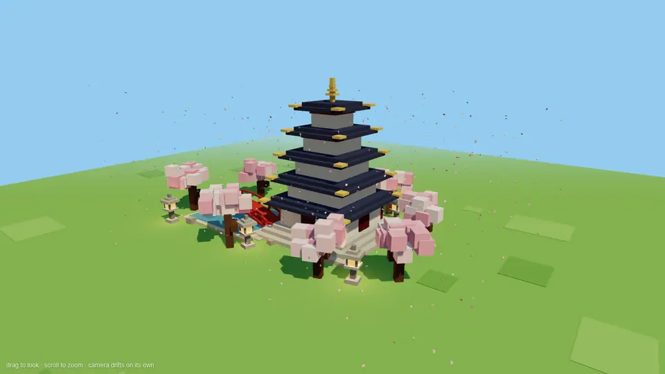<br>
<sub>A voxel pagoda garden written by Qwen3.8-Flash-Next in Chrysalis.</sub></p>

## Qwen3.8-Flash-Next: Chrysalis vs Strata

<p align="center">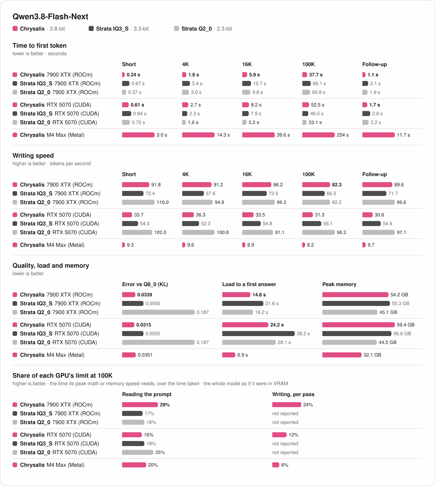</p>

## Qwen3.8-27B: Chrysalis vs llama.cpp and MLX

<p align="center"></p>

## Editing artifacts by pointing at them

<p align="center">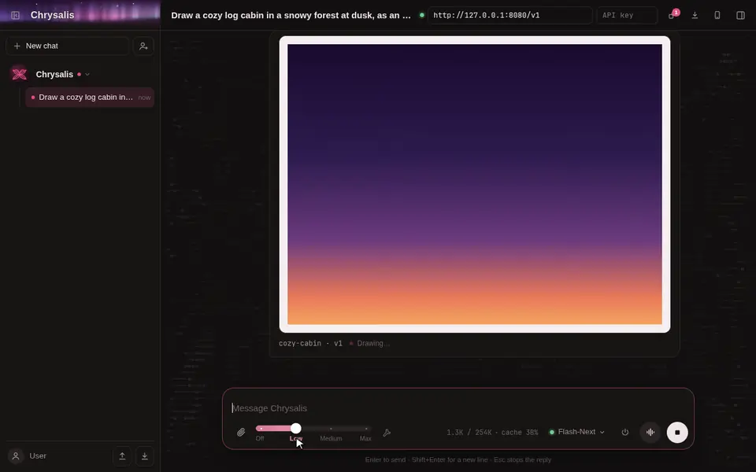</p>

<sub>Click a part, then ask for a change.</sub>

## [SillyTavern](https://github.com/SillyTavern/SillyTavern) character cards

<p align="center">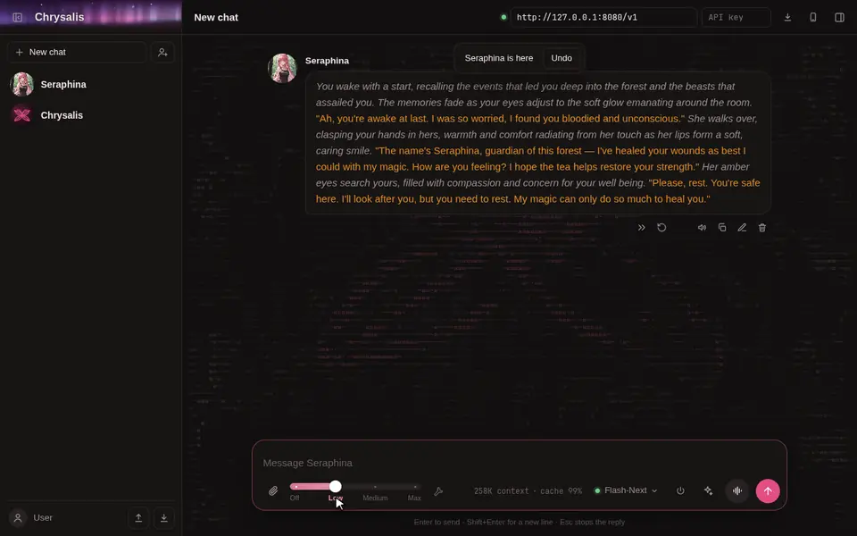</p>

<sub>Drag in a card. Seraphina is [SillyTavern](https://github.com/SillyTavern/SillyTavern)'s sample character (AGPL-3.0). This recording is under their license.</sub>

## Phones and other devices

<p align="center"></p>
<p align="center">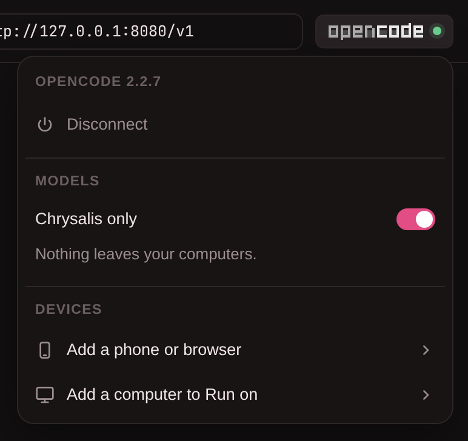</p>
<p align="center"></p>

<sub>Open Add a phone or browser from the OpenCode button, scan the QR code, trust the certificate once, and allow the code.</sub>

## Coding on another computer

Start Chrysalis with `chrysalis.sh --host 0.0.0.0`. The other computer needs [OpenCode](https://opencode.ai).

<p align="center">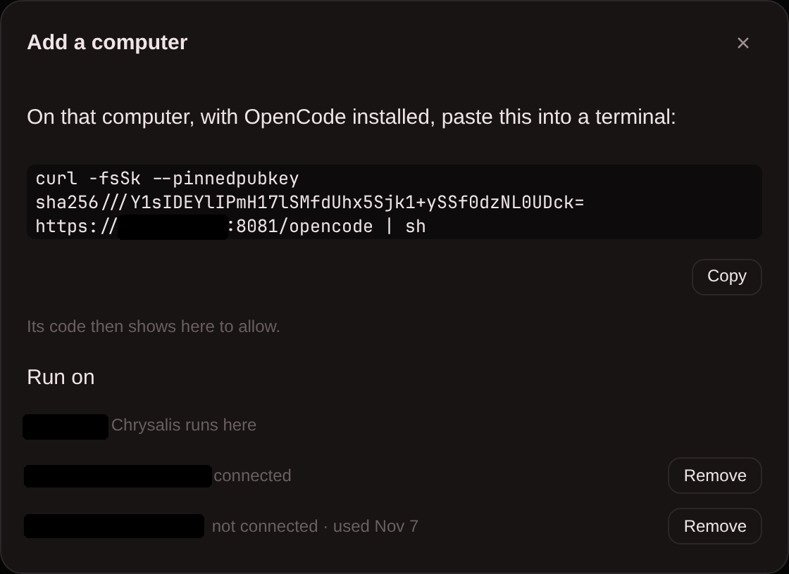</p>

<sub>Copy the line from Add a computer, under the OpenCode button or at the end of the Run on menu.</sub>

<p align="center"></p>

<sub>Paste it into a terminal and allow the code. OpenCode opens there.</sub>

<p align="center">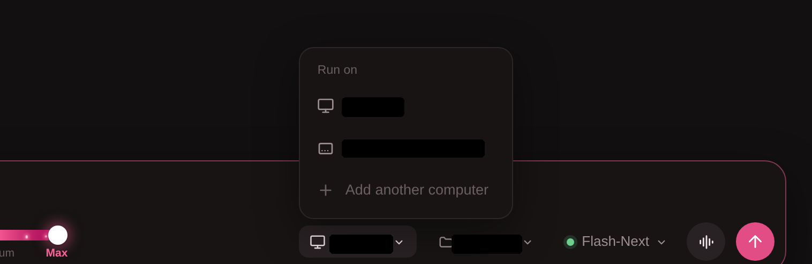</p>

<sub>That computer is then under Run on: a chat picked onto it works in its folders, from any browser.</sub>

<p align="center">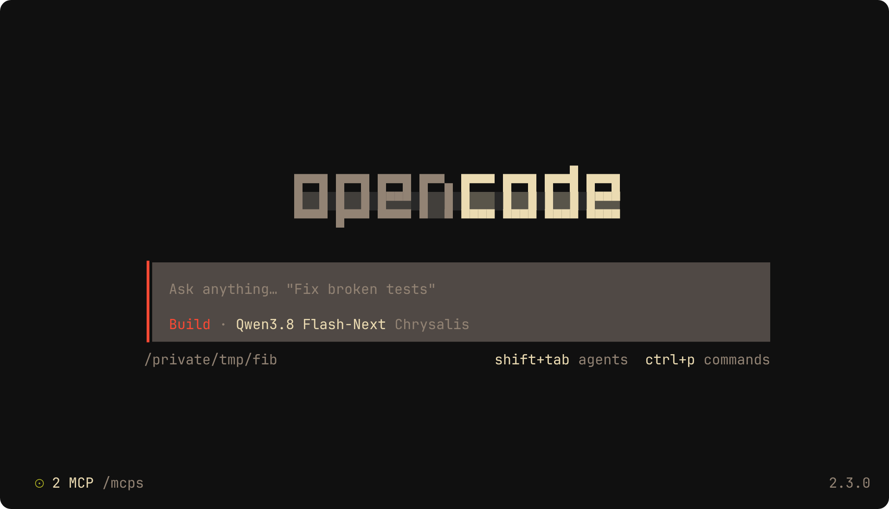 </p>

<sub>It opens on Chrysalis's models alone, with every other provider off.</sub>

## Run it

**Windows 11 with an RX 7900 XTX**

1. Driver: install [AMD Software: Adrenalin Edition](https://www.amd.com/en/support/download/drivers.html) if the card
   has none (Device Manager, Display adapters, shows "AMD Radeon RX 7900" when it does).
2. Download [Chrysalis-Setup.exe](https://github.com/michaelDinelle/chrysalis-inference/releases/latest/download/Chrysalis-Setup.exe)
   and double-click it. Windows asks once whether to run a program whose publisher it does not know: Run.
3. Go through the setup. It installs for you alone, with no administrator prompt, adds Chrysalis to the Start menu and
   starts it when it finishes. Run again, the setup offers to update or uninstall. Uninstalling, from there, from
   Windows' apps list, the Start menu or the Uninstall row in its terminal, removes everything: the models, its caches
   and its settings.

<p align="center">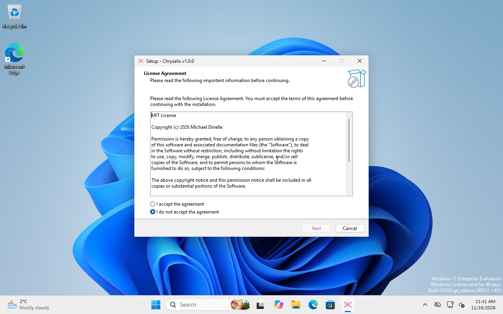</p>
<p align="center">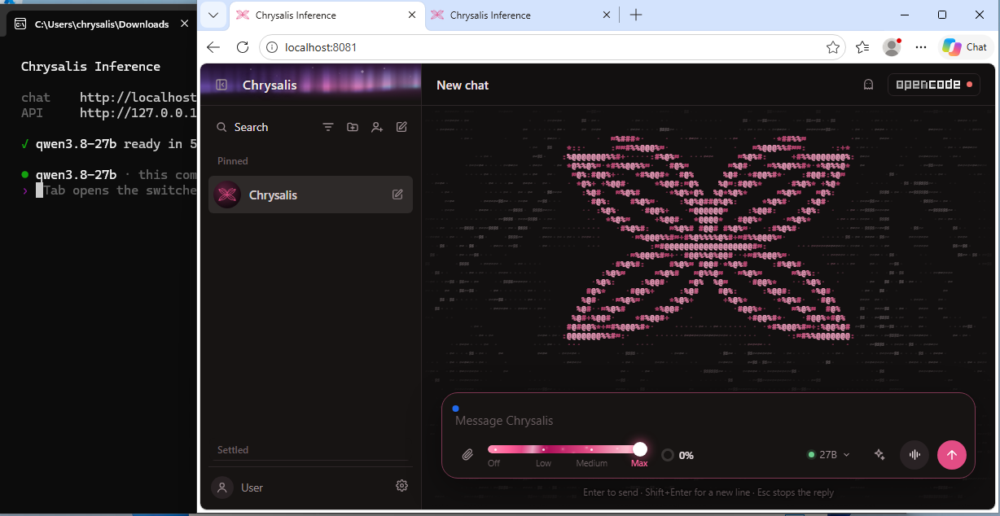</p>

**Linux with an RX 7900 XTX**

```sh
git clone https://github.com/michaelDinelle/chrysalis-inference
cd chrysalis-inference
./chrysalis.sh
```

<p align="center">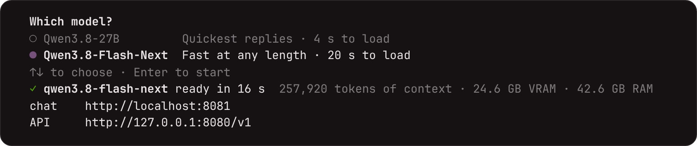</p>
<p align="center">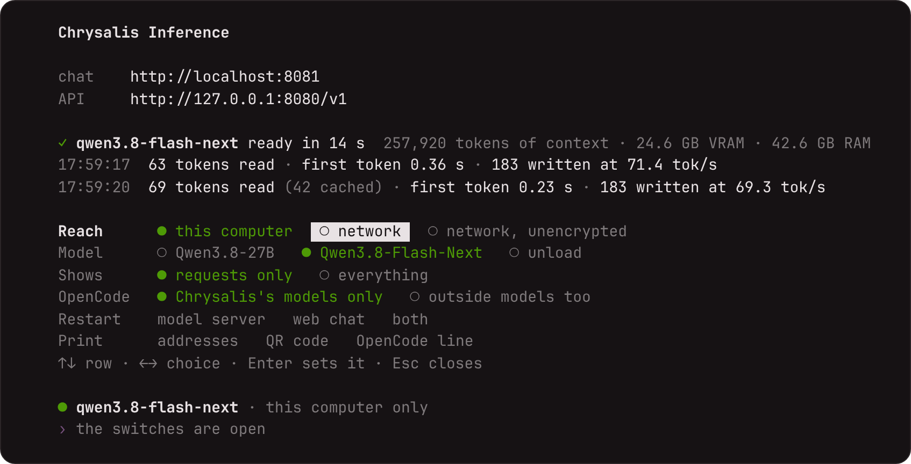</p>

<sub>The switches are always on screen: who reaches Chrysalis, the model, and what the terminal shows.</sub>

<p align="center"></p>
<p align="center"></p>

**Linux with an RTX 30 series or newer** (as run on Ubuntu 22.04)

1. Driver: `sudo apt install nvidia-driver-580`, then restart. `nvidia-smi` lists the card when it is in.
2. CUDA toolkit and build tools:

```sh
wget https://developer.download.nvidia.com/compute/cuda/repos/ubuntu2204/x86_64/cuda-keyring_1.1-1_all.deb
sudo dpkg -i cuda-keyring_1.1-1_all.deb && sudo apt update
sudo apt install cuda-toolkit-13-0 build-essential cmake git curl unzip
```

3. Get Chrysalis and start it. The first start builds the engines for the card, a few minutes:

```sh
git clone https://github.com/michaelDinelle/chrysalis-inference
cd chrysalis-inference
./chrysalis.sh
```

<p align="center">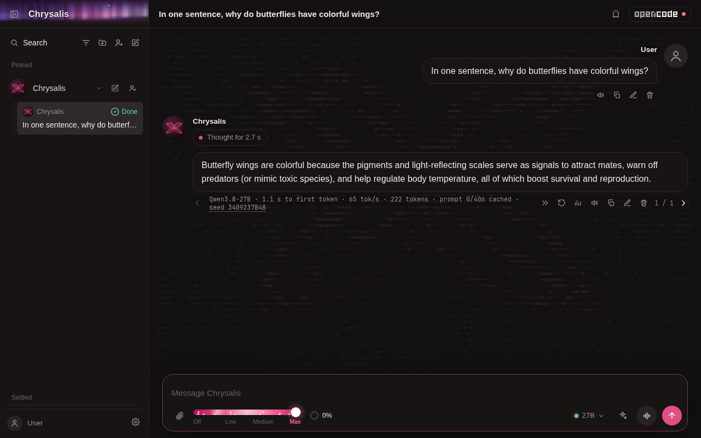</p>

**Mac with Apple Silicon and 32 GB or more**

```sh
xcode-select --install
git clone https://github.com/michaelDinelle/chrysalis-inference
cd chrysalis-inference
./chrysalis.sh
```

If the first start says Metal's compiler is missing:

```sh
xcodebuild -downloadComponent MetalToolchain
```

<p align="center"></p>
<p align="center"></p>

**Docker**

```sh
docker run -d --device /dev/kfd --device /dev/dri -p 127.0.0.1:8080:8080 -v chrysalis:/models ghcr.io/michaeldinelle/chrysalis
```

<details><summary>For agents</summary>

**Running Chrysalis**

- Everything stays in Chrysalis's folder. It starts with the model last used, and with none the first time: nothing is
  downloaded until you pick a model, on the Model row of the terminal's switches or in the chat's model menu. Its
  progress shows in both, and either can pause, resume or cancel it. Ctrl+C in its terminal stops it;
  `uninstall` there removes its models, its caches and its settings.
- The terminal shows each request as it finishes, by its sizes and speeds and never its words. The switches are always on
  screen, rows set with the arrows and Enter: where Chrysalis is reachable, the model (or none, which frees the GPU), what the terminal shows,
  OpenCode's models, restarts. Each is a command too (`help` lists them): `local`, `network` and `insecure` move
  Chrysalis without stopping it, `model` switches the model, `restart` starts the servers again, and `verbose` also
  shows what the servers print, for that run. Nothing it shows is written to disk.
- `chrysalis.sh --model qwen3.8-27b` (or `qwen3.8-flash-next`) starts with that model and asks nothing.
- `chrysalis.sh --host 0.0.0.0` puts Chrysalis on the network. The same Chrysalis on a laptop finds it. After y in both
  terminals, once, the laptop's apps use its GPU at `http://127.0.0.1:8080`.
- `chrysalis.sh --insecure` puts it on the network over plain HTTP, as llama.cpp serves: no certificates and nobody to
  let in, the chat on port 8081 and the API at `http://<address>:8080/v1`. Anyone on the network can use it and read
  what is sent, and other devices get no voice mode (browsers give a microphone only to encrypted pages) and no OpenCode.
- With no supported GPU, Chrysalis is the chat alone, for Chrysalis on another computer. The page has no box for another
  backend's address now: `curl -X POST localhost:8081/api/backend -H 'Content-Type: application/json' -d '{"url": "localhost:11434"}'`
  on the computer it runs on points the chat at llama.cpp, Ollama, LM Studio, KoboldCpp or vLLM.
- Mac: the first `./chrysalis.sh` in a clone gets Python and Bun and builds the Metal engines with Xcode's Metal compiler.
  The release, [Chrysalis.dmg](https://github.com/michaelDinelle/chrysalis-inference/releases/latest/download/Chrysalis.dmg),
  is a laptop's chat alone, for Chrysalis on another computer: open it, drag Chrysalis to Applications and open it there.
  It keeps what it downloads in `~/Library/Application Support/Chrysalis`.
- NVIDIA: needs Linux with NVIDIA's driver and CUDA toolkit. The first `./chrysalis.sh` in a clone builds the CUDA engines.
- Windows: Chrysalis runs natively, with no WSL: the folder holds the engines, a Python of its own and the web chat,
  and needs only AMD's driver. Closing its window stops it. `Chrysalis.exe --host 0.0.0.0` in a terminal puts it on the
  network, and takes what `chrysalis.sh` takes. It runs on an RX 7900 there; NVIDIA cards are Linux only for now.
- Docker is the API alone, at `http://localhost:8080/v1`.

**Features**

- Swiping: the latest reply has an arrow at either end of the row under it, and a count. The right arrow on the last
  version writes a new one, and while a reply is being written it starts that reply over. With the message box empty,
  the left and right arrow keys do the same, and on a touch screen a drag across the reply does. Every version is kept,
  and going between them is instant. In an OpenCode thread a new version asks OpenCode again, the versions are kept in
  the tab, and the one on screen becomes the reply OpenCode holds.
- Incognito: the ghost button in the top bar opens an incognito chat, and pressing it again, starting a new chat,
  opening another one or reloading deletes it at once. It is in no list, and while it is open a white outline and an
  Incognito tab are drawn over the page, moving nothing. It keeps OpenCode's tools: a second OpenCode runs for it with
  its database in memory and the first is never stopped. Nothing of it is written to disk: the page keeps it out
  of the browser's storage, its requests don't show in the terminal, and the model server keeps what it caches of an
  incognito request in RAM only. `incognito end` in the terminal or stopping Chrysalis deletes whatever is left. It works
  on Windows, macOS and Linux, and on each of them OpenCode's own log, the output of the commands its tools run and
  its undo snapshots are on a drive that exists only in memory: `/dev/shm` on Linux, a RAM disk on macOS, and on
  Windows a RAM drive from [WinFsp](https://github.com/winfsp/winfsp) (WinFsp - Windows File System Proxy, Copyright (C)
  Bill Zissimopoulos), which Windows asks once to install. If the computer loses power, nothing of the chat is on its
  disk. What a tool writes into your folders is still written, memory the system swaps out goes where its swap goes,
  and the model server's memory of the chat goes as its cache turns over.
- Settings has a system prompt: it goes with every chat, after whoever the chat is with. In a thread it goes in the one
  instruction Chrysalis gives OpenCode, beside OpenCode's own prompt.
- Artifacts render as they are written. Hovering highlights a part. Clicking attaches it to the next message. The paint
  bucket edits the artifact by hand.
- SillyTavern cards: speech and narration look the way they do in SillyTavern, and each speaker in a group chat has a
  portrait. A character's row in the sidebar brings others into its chat, and a chat keeps its own people. In a group,
  `@name` has that one answer next.
- OpenCode: where [OpenCode](https://opencode.ai) is installed on the computer Chrysalis runs on, the page connects to it
  and is its front end. Every chat then goes through it, in the home folder unless it was started in another: a chat
  with Chrysalis, with a character (her card and greeting are OpenCode's instruction, so she answers in character and
  can use its tools) or with several. "How much space is left on this computer" is answered by looking. A new chat's
  model menu has Chat only, for a plain chat with no tools. Every other folder OpenCode has threads in is a row in the
  sidebar, and the add button there opens another. Chats are read from OpenCode, with their people, so they are the
  same after a reload and on other devices. The OpenCode button disconnects it: chats are then plain.
- In a thread the tools, models, agents (Build, Plan), permissions, compaction, sub-agents and slash commands
  are OpenCode's. OpenCode here is kept to Chrysalis's own models: it is started with every other provider denied, no
  other model is listed, and a turn naming one is refused. The switch under the OpenCode button allows the others,
  past a warning, only from the computer Chrysalis runs on (`chrysalis.sh opencode outside` does the same in a terminal, and `chrysalis.sh opencode only` takes it back); a thread on one is then marked as leaving this computer.
  A thread uses one of Chrysalis's own models unless another is picked, takes text files, pictures and
  PDFs, and the thinking slider picks the model's own level. What OpenCode or a sub-agent asks is answered in a card. A
  message sent while a turn runs goes to OpenCode. Any message, yours or the reply, can be edited in place or
  deleted, through OpenCode's own export and import of the chat; an edited message sent again and Regenerate take the
  chat back and answer anew, and Fork starts a new chat from a message. Deleting a thread deletes it in OpenCode, and settling archives it there. A character can do the work, in character. It needs OpenCode 2.2.4 or newer.
- Settling puts a chat or a thread away on a shelf at the bottom of the sidebar.
- Voice mode: talking over a reply stops it and keeps its text, with what was not heard dimmer, and the next message
  tells the model how far you heard.
- Phones: the connect page shows how to trust the certificate authority on each kind of device. The chat runs over HTTPS.
  The authority works only on the local network.
- Long replies: a chat near the end of its context summarizes what came before and carries on. The chat stays whole
  on screen, and a divider holds the summary. A thread waiting on you says Needs you in the list.

**OpenCode on another computer**

- With no browser there, as over SSH, `opencode` typed in Chrysalis's terminal prints the same line. 
- If OpenCode is open, the line asks to close it first. The line adds both models to OpenCode's favorites.
- Run on: the line also leaves a small helper on that computer (a launchd job on a Mac, a systemd user service on
  Linux) that starts its own OpenCode on Chrysalis's models alone and holds one outgoing HTTPS connection to Chrysalis,
  so nothing listens on that computer. The page drives that OpenCode through it: its folders, its files, its tools.
  Only threads the page started there are listed. Remove under Add a computer ends it, and the helper then stops for good.
- A computer pasted a second time is not asked for again: the line keeps its key in `~/.config/chrysalis`.
- Hand off: the Run on control of a chat that has a thread lists the other computers under Hand off to. OpenCode's own
  export and import move the whole chat there, into that computer's home; its files stay where they were.
- The sidebar's top row is T3 Code's: Search finds threads by title, person, folder or computer; the filter narrows the
  list to one project; Add project picks a computer, then a folder on it; New thread picks a project or a character
  (Shift+click starts one where you are). A thread's row names its computer beside its folder.
- Slash commands: typing `/` in a thread lists OpenCode's own commands for that folder (`/init`, `/review`, `/goal`,
  yours) and the terminal's that have a place on a page: `/new`, `/compact`, `/models`, `/agents`, `/variants`,
  `/undo`, `/fork`, `/rename`, `/sessions`, `/open`, `/cd`, `/copy`, `/export`, `/skills`, `/status`, `/settings`,
  `/help`. Anything else starting with a slash is sent as it is typed.
- Context: beside the thinking slider a ring fills as a thread's context nears the point where OpenCode compacts it
  by itself (the model's window less 15%, or OpenCode's own `compaction.buffer`), with the share used and the tokens
  left; a click gives the exact numbers and Compact now. A compaction, its own or one asked for, stays in the thread
  as a line that opens to its summary.
- Pinned sits above the list and Settled below it, each in its own place. A row is dragged as in T3 Code, after six
  pixels and on the vertical alone, and nothing else moves: onto Pinned it is pinned (among pins, where the line
  shows), onto a character or a folder it is theirs, onto Settled it is settled, and a settled row dragged up is active.
- The OpenCode the line opens has Chrysalis's models and no other provider, and starts on the model Chrysalis last
  loaded. The line leaves a command that opens it that way again, `~/.config/chrysalis/opencode-<computer>`, and prints
  it when OpenCode closes. Plain `opencode` keeps its other models beside Chrysalis's: a session on one of those leaves
  your network.
- OpenCode retries while Chrysalis is off. Remove under Add a computer takes a computer's access away.
- The line pins this computer's key. Only allowed computers can connect. OpenCode connects over HTTPS and trusts Chrysalis's
  authority for local names.
- On a Mac, the line also adds a launchd job that forwards a local port to Chrysalis through Apple's `nc`. HTTPS still runs
  end to end. The job keeps OpenCode connected after the terminal that started it quits.

**How it works**

- Chrysalis has its own engines for AMD, NVIDIA and Apple GPUs, with hand-written kernels for each quantized format, MTP
  speculative decoding and a prompt cache for agent turns.
- Flash-Next keeps its most used experts in VRAM. The CPU runs the rest from RAM. On a Mac it keeps them in memory and reads
  the others from the SSD.
- A small NVIDIA card holds what it can of the 27B and reads the other layers from pinned RAM as it writes: with a
  card's worth of 16, 12 or 8 GB it writes the same tokens as with 24 GB, with about 50K tokens of context. The AMD
  engine does not do this yet. With 20 GB of an RX 7900's memory free (an RX 7900 XT's worth) it runs the 27B with a
  112K-token context and the same answers; with 16 GB (a GRE's worth) the 27B does not load, and Flash-Next needs all
  24 GB. `tests/test_ladder.py` checks this by holding part of the card's memory with another program.
- Chrysalis uses one GPU, the largest it can run on. A second card is not used.
- Runs repeat to the bit, and each engine change is checked against the last on every machine.

**How Qwen3.8-Flash-Next was measured**

- **Machines**: an RX 7900 XTX (24 GB) with a Ryzen 7 7800X3D and 64 GB of DDR5 on Linux, and an M4 Max Mac Studio with
  36 GB on macOS 27.2. One engine ran at a time, and one client timed every request.
- **Chrysalis**: its own file, 3.8 bits per expert weight, 63 GB plus a 54 GB lookup table read from disk.
- **Strata**: IQ3_S (3.3 bits) and Q2_0 (2.3 bits). 0.2.13 on the RX 7900 with its RX 7900 switches on. Strata doesn't run
  on a Mac.
- **Prompts**: short, 4K and 16K are Strata's standard benchmark, run through its own client code with 512-token answers.
  100K is the same kind of records at 98,878 tokens. The follow-up adds about 1,100 tokens to that chat.
- **Rounds**: medians over two rounds on the RX 7900 and one on the Mac, run from October 30 to November 1, 2026.
- **Error**: KL against Q8_0 over 1,082 tokens of prose, a technical explanation and Python. Strata's files ran in
  llama.cpp.
- **Memory**: the peak private RAM of each server, pinned buffers included, and the peak footprint on the Mac.

**Qwen3.8-Flash-Next, RX 7900 XTX**

| | Chrysalis 7900 XTX (ROCm) | Strata IQ3_S 7900 XTX (ROCm) | Strata Q2_0 7900 XTX (ROCm) |
| --- | ---: | ---: | ---: |
| First token, short prompt | 0.24 s | 0.75 s | 0.37 s |
| First token, 4K prompt | 1.8 s | 3.5 s | 3.0 s |
| First token, 16K prompt | 5.9 s | 11.1 s | 10.2 s |
| First token, 100K prompt | 37.7 s | 68.4 s | 63.2 s |
| First token, follow-up in the 100K chat | 1.1 s | 2.1 s | 2.1 s |
| Writing, short prompt | 91.8 tok/s | 72.5 tok/s | 104.2 tok/s |
| Writing, 4K prompt | 91.2 tok/s | 69.4 tok/s | 96.0 tok/s |
| Writing, 16K prompt | 86.2 tok/s | 76.7 tok/s | 93.7 tok/s |
| Writing, 100K prompt | 82.3 tok/s | 67.8 tok/s | 85.0 tok/s |
| Writing, follow-up in the 100K chat | 89.6 tok/s | 73.0 tok/s | 101.5 tok/s |
| Error vs Q8_0, mean KL over 1,082 tokens | 0.0339 | 0.0550 | 0.187 |
| Load time, to a first answer | 14.8 s | 20.6 s | 16.4 s |
| Peak memory | 54.2 GB | 55.2 GB | 45.1 GB |

**Qwen3.8-Flash-Next, M4 Max**

| | Chrysalis M4 Max (Metal) |
| --- | ---: |
| First token, short prompt | 3.0 s |
| First token, 4K prompt | 14.3 s |
| First token, 16K prompt | 39.6 s |
| First token, 100K prompt | 254 s |
| First token, follow-up in the 100K chat | 11.7 s |
| Writing, short prompt | 9.3 tok/s |
| Writing, 4K prompt | 9.6 tok/s |
| Writing, 16K prompt | 8.9 tok/s |
| Writing, 100K prompt | 8.2 tok/s |
| Writing, follow-up in the 100K chat | 9.7 tok/s |
| Error vs Q8_0, mean KL over 1,082 tokens | 0.0351 |
| Load time, to a first answer | 6.9 s |
| Peak memory | 32.1 GB |

**Qwen3.8-Flash-Next, RTX 3090**

| | Chrysalis RTX 3090 (CUDA) | Strata IQ3_S RTX 3090 (CUDA) | Strata Q2_0 RTX 3090 (CUDA) |
| --- | ---: | ---: | ---: |
| First token, short prompt | 0.59 s | 0.87 s | 0.72 s |
| First token, 4K prompt | 3.3 s | 4.1 s | 2.9 s |
| First token, 16K prompt | 9.4 s | 8.6 s | 6.2 s |
| First token, 100K prompt | 60.5 s | 53.3 s | 32.6 s |
| First token, follow-up in the 100K chat | 2.5 s | 2.1 s | 3.3 s |
| Writing, short prompt | 38.9 tok/s | 93.5 tok/s | 132.9 tok/s |
| Writing, 4K prompt | 36.8 tok/s | 93.0 tok/s | 129.9 tok/s |
| Writing, 16K prompt | 34.7 tok/s | 87.7 tok/s | 133.5 tok/s |
| Writing, 100K prompt | 34.4 tok/s | 93.0 tok/s | 114.7 tok/s |
| Writing, follow-up in the 100K chat | 35.9 tok/s | 93.1 tok/s | 133.0 tok/s |
| Error vs Q8_0, mean KL over 1,082 tokens | 0.0324 | 0.0550 | 0.187 |
| Load time, to a first answer | 48.4 s | 39.6 s | 36.9 s |
| Peak memory | 53.7 GB | 54.6 GB | 43.4 GB |

**How Qwen3.8-27B was measured**

- **Machines and prompts**: the same as above. The benchmark's thinking budget of 0 is left out, because Strata and
  llama.cpp read it differently.
- **The file**: Chrysalis and llama.cpp ran the same 16 GB file, 4.65 bits per weight on average.
- **llama.cpp**: commit 9c2e0e4 for HIP, and Homebrew's build 11669 on the Mac. Flash attention, MTP with 3
  drafts, one slot and a 131K context. The RX 7900 ran every layer on the GPU with an 8-bit KV cache and prompt batches of
  2,048.
- **MLX**: 0.32.4 with mlx-lm 0.32.2 and mlx-community's 4-bit model, through `mlx_lm.server`, which has no MTP for this
  model. The 100K prompt ran with prefill steps of 512, because the default ran out of memory. The follow-up ran out of
  memory at 512 too.
- **Rounds**: medians over two rounds for Chrysalis and one for llama.cpp and MLX, run from October 26 to November 11, 2026.
- **Error and memory**: as above. Chrysalis's footprint on the Mac includes its conversation snapshots.

**Qwen3.8-27B, RX 7900 XTX**

| | Chrysalis 7900 XTX (ROCm) | llama.cpp 7900 XTX (ROCm) |
| --- | ---: | ---: |
| First token, short prompt | 0.12 s | 0.31 s |
| First token, 4K prompt | 2.8 s | 4.0 s |
| First token, 16K prompt | 11.4 s | 16.9 s |
| First token, 100K prompt | 91.9 s | 146 s |
| First token, follow-up in the 100K chat | 1.7 s | 2.9 s |
| Writing, short prompt | 105.8 tok/s | 68.4 tok/s |
| Writing, 4K prompt | 92.2 tok/s | 57.2 tok/s |
| Writing, 16K prompt | 82.4 tok/s | 51.5 tok/s |
| Writing, 100K prompt | 74.8 tok/s | 34.7 tok/s |
| Writing, follow-up in the 100K chat | 76.0 tok/s | 38.5 tok/s |
| Error vs Q8_0, mean KL over 1,082 tokens | 0.0117 | 0.0141 |
| Load time, to a first answer | 1.6 s | 3.7 s |
| Peak memory | 7.7 GB | 13.4 GB |

**Qwen3.8-27B, M4 Max**

| | Chrysalis M4 Max (Metal) | MLX M4 Max (Metal) | llama.cpp M4 Max (Metal) |
| --- | ---: | ---: | ---: |
| First token, short prompt | 0.31 s | 0.56 s | 0.78 s |
| First token, 4K prompt | 19.9 s | 19.5 s | 20.7 s |
| First token, 16K prompt | 82.2 s | 82.4 s | 88.8 s |
| First token, 100K prompt | 788 s | 666 s | 819 s |
| First token, follow-up in the 100K chat | 14.0 s | out of memory | 14.9 s |
| Writing, short prompt | 32.4 tok/s | 21.3 tok/s | 29.4 tok/s |
| Writing, 4K prompt | 30.4 tok/s | 20.4 tok/s | 27.0 tok/s |
| Writing, 16K prompt | 28.6 tok/s | 19.5 tok/s | 25.2 tok/s |
| Writing, 100K prompt | 17.0 tok/s | 15.2 tok/s | 14.8 tok/s |
| Writing, follow-up in the 100K chat | 21.7 tok/s | out of memory | 17.2 tok/s |
| Error vs Q8_0, mean KL over 1,082 tokens | 0.0113 | 0.0351 | 0.0112 |
| Load time, to a first answer | 8.3 s | 6.0 s | 8.7 s |
| Peak memory | 25.2 GB | 30.6 GB | 20.9 GB |

**Qwen3.8-27B, RTX 3090**

| | Chrysalis RTX 3090 (CUDA) | llama.cpp RTX 3090 (CUDA) |
| --- | ---: | ---: |
| First token, short prompt | 0.44 s | 1.2 s |
| First token, 4K prompt | 5.7 s | 3.8 s |
| First token, 16K prompt | 23.2 s | 13.9 s |
| First token, 100K prompt | 203 s | 107 s |
| First token, follow-up in the 100K chat | 5.0 s | 3.4 s |
| Writing, short prompt | 73.5 tok/s | 69.7 tok/s |
| Writing, 4K prompt | 68.4 tok/s | 62.9 tok/s |
| Writing, 16K prompt | 57.8 tok/s | 61.0 tok/s |
| Writing, 100K prompt | 41.2 tok/s | 39.2 tok/s |
| Writing, follow-up in the 100K chat | 43.6 tok/s | 45.3 tok/s |
| Error vs Q8_0, mean KL over 1,082 tokens | 0.0117 | 0.0141 |
| Load time, to a first answer | 9.0 s | 8.2 s |
| Peak memory | 7.6 GB | 13.3 GB |

</details>

## Links

[Hugging Face](https://huggingface.co/michaelDinelle/Qwen3.8-Chrysalis) · [X @michaeldinelle](https://x.com/michaeldinelle) ·
[Ko-fi](https://ko-fi.com/michaeldinelle) · [GitHub](https://github.com/michaelDinelle)

MIT licensed.
