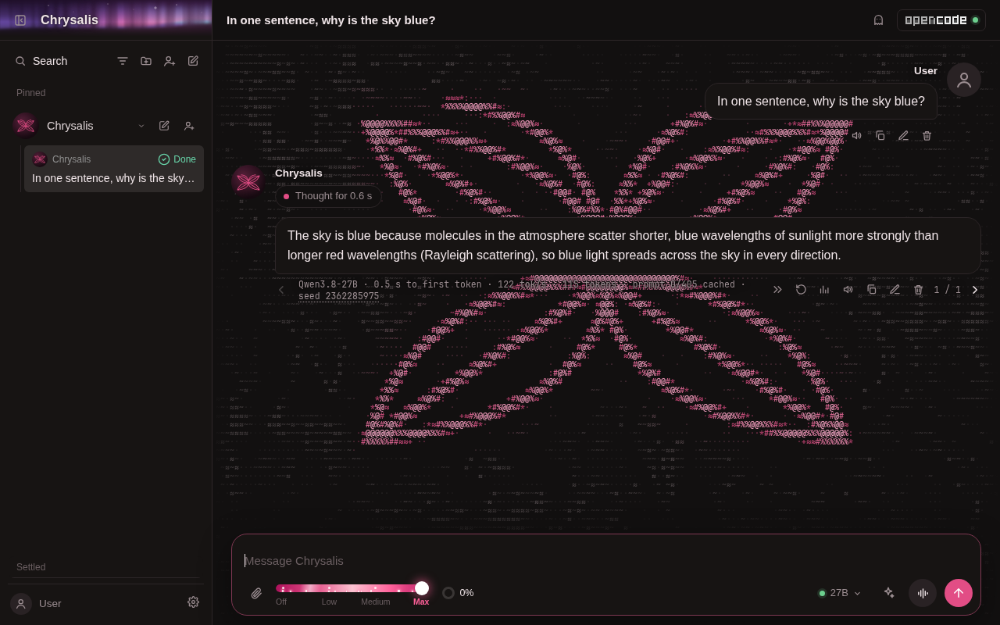
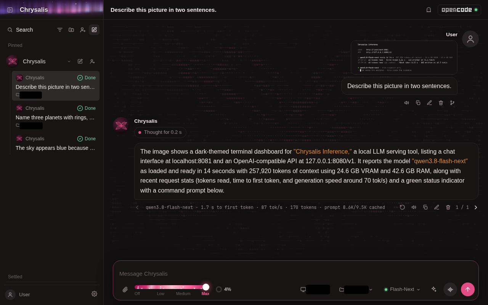

# Chrysalis on Linux with an RX 7900 XTX

```sh
git clone https://github.com/michaelDinelle/chrysalis-inference
cd chrysalis-inference
./chrysalis.sh
```

<p align="center"></p>
<p align="center"></p>
