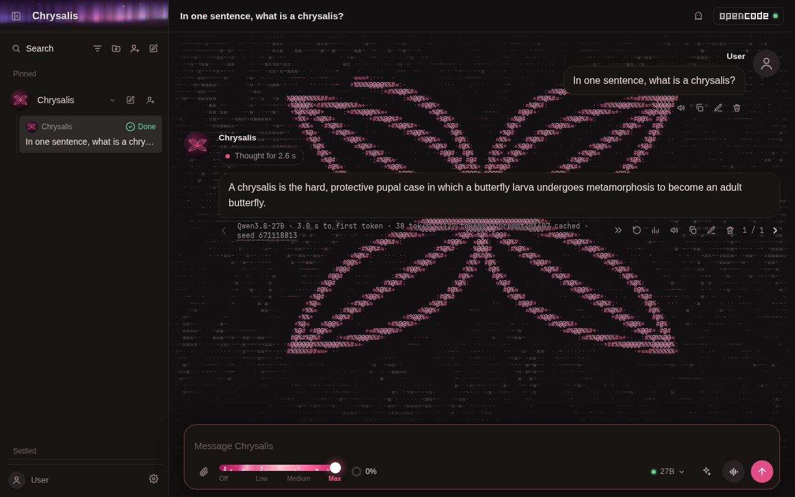
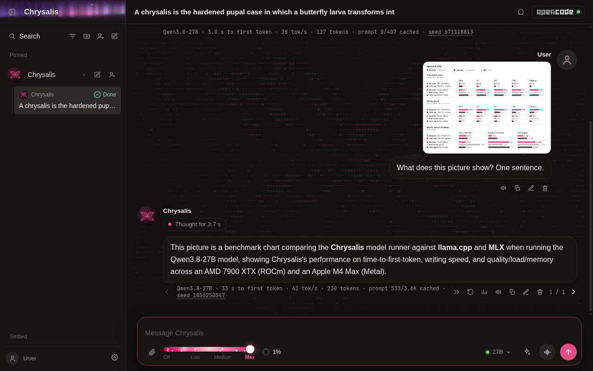

# Chrysalis on a Mac with Apple Silicon and 32 GB or more

```sh
xcode-select --install
git clone https://github.com/michaelDinelle/chrysalis-inference
cd chrysalis-inference
./chrysalis.sh
```

If the first start says Metal's compiler is missing:

```sh
xcodebuild -downloadComponent MetalToolchain
```

<p align="center"></p>
<p align="center"></p>

The release, [Chrysalis.dmg](https://github.com/michaelDinelle/chrysalis-inference/releases/latest/download/Chrysalis.dmg),
is a laptop's chat alone, for Chrysalis on another computer: open it, drag Chrysalis to Applications and open it there.
