# Chrysalis on Windows, step by step

Windows 11 and a Radeon RX 7900 XTX with [AMD's driver](https://www.amd.com/en/support/download/drivers.html).
Every picture below is from a real run of these steps on that PC.

## 1. Get Chrysalis

Download [Chrysalis-Setup.exe](https://github.com/michaelDinelle/chrysalis-inference/releases/latest/download/Chrysalis-Setup.exe)
and open it from Downloads. If Windows says it protected your PC from an unrecognised app: **More info**, then
**Run anyway**.

<p align="center">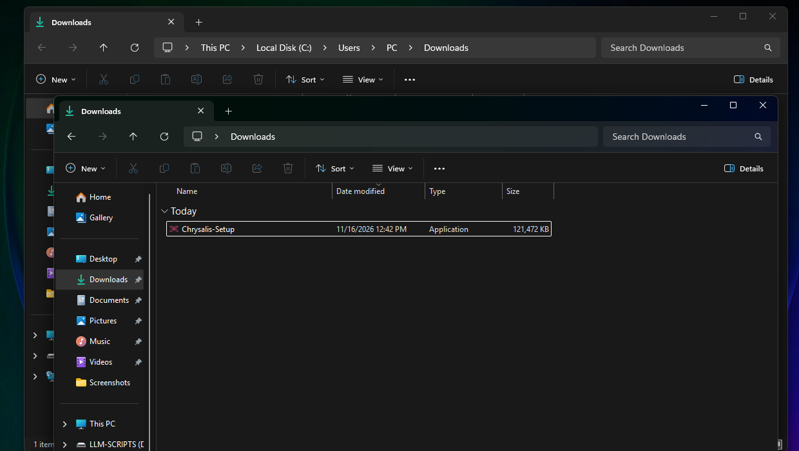</p>

## 2. Install it

| | |
|---|---|
| **I accept the agreement**, then **Next** | 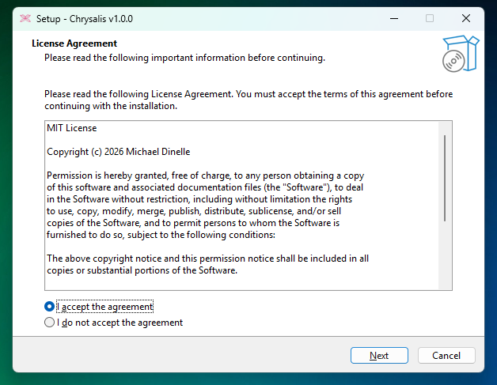 |
| **Next** | 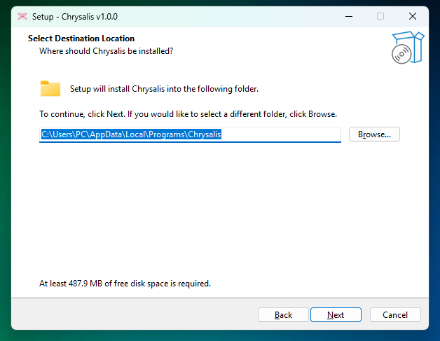 |
| Tick **Create a desktop shortcut** if you want one, then **Next** | 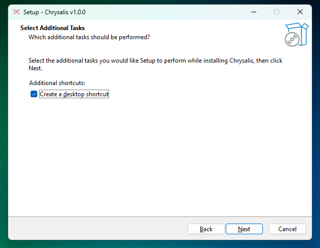 |
| **Install** | 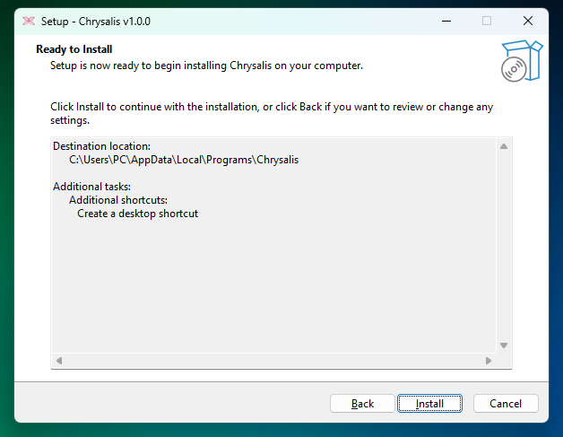 |
| **Finish**, with **Launch Chrysalis** ticked | 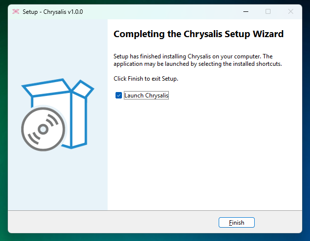 |

No administrator prompt: it installs for you alone.

## 3. First start

The terminal opens with the switches, and the chat opens in your browser. Nothing is downloaded yet.

<p align="center">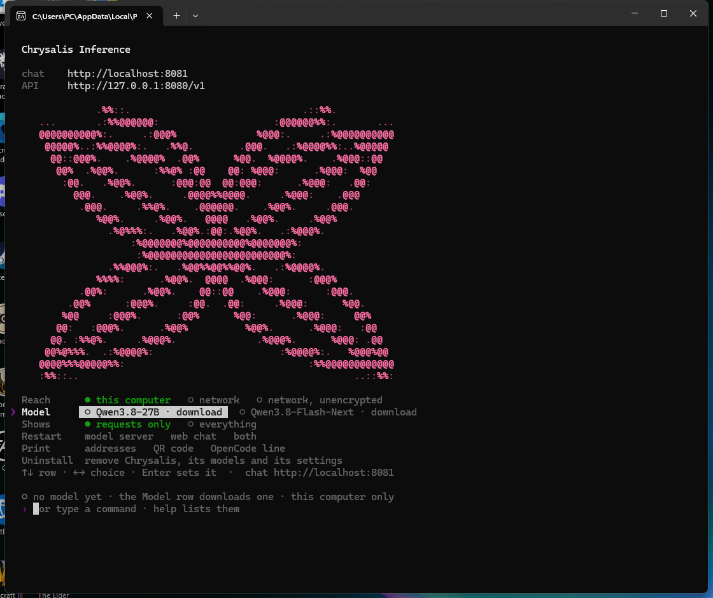</p>
<p align="center">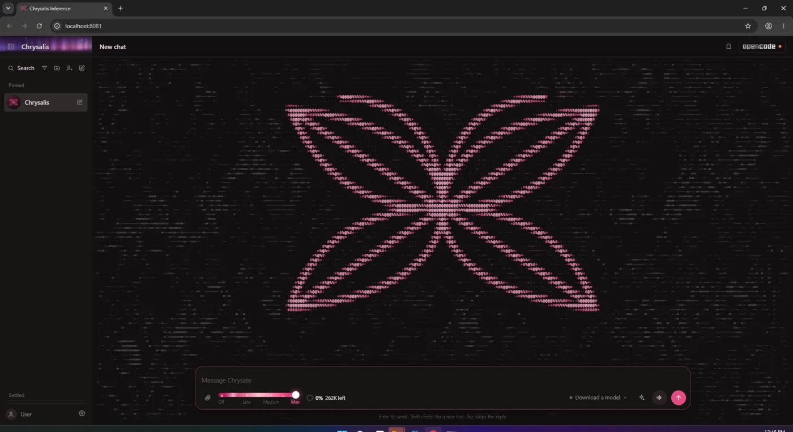</p>

## 4. Download a model

In the terminal, **Model** is already highlighted with **Qwen3.8-27B · download** picked: press **Enter**
(or **→**, then **Enter**, for Flash-Next). The chat's model button offers the same, and shows the download too.

<p align="center">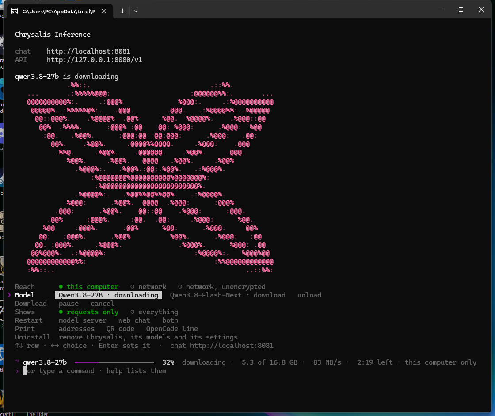</p>

The **Download** row pauses or cancels it. When it finishes, the model loads:

<p align="center">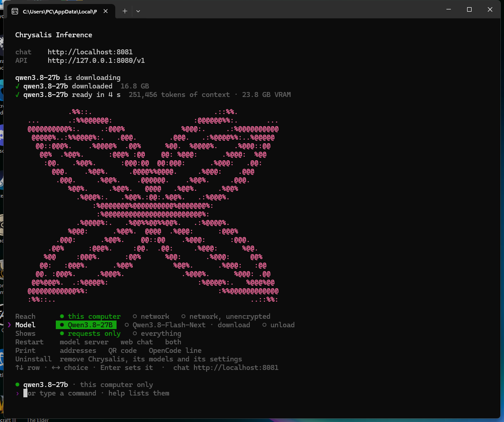</p>

## 5. Chat

<p align="center">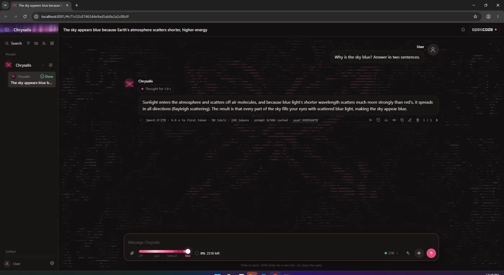</p>

## 6. Get Node.js (for OpenCode)

OpenCode gives the chat tools: files, a terminal, the web. It installs with npm, which comes with Node.js.

Open [nodejs.org/en/download](https://nodejs.org/en/download) and click **Windows Installer (.msi)**.

<p align="center">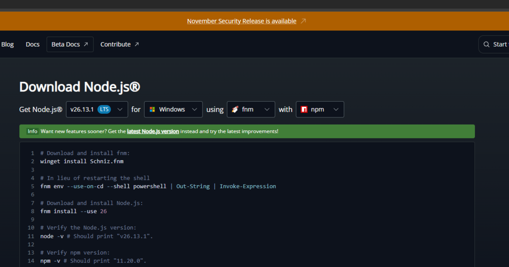</p>

Open it from the download list.

<p align="center">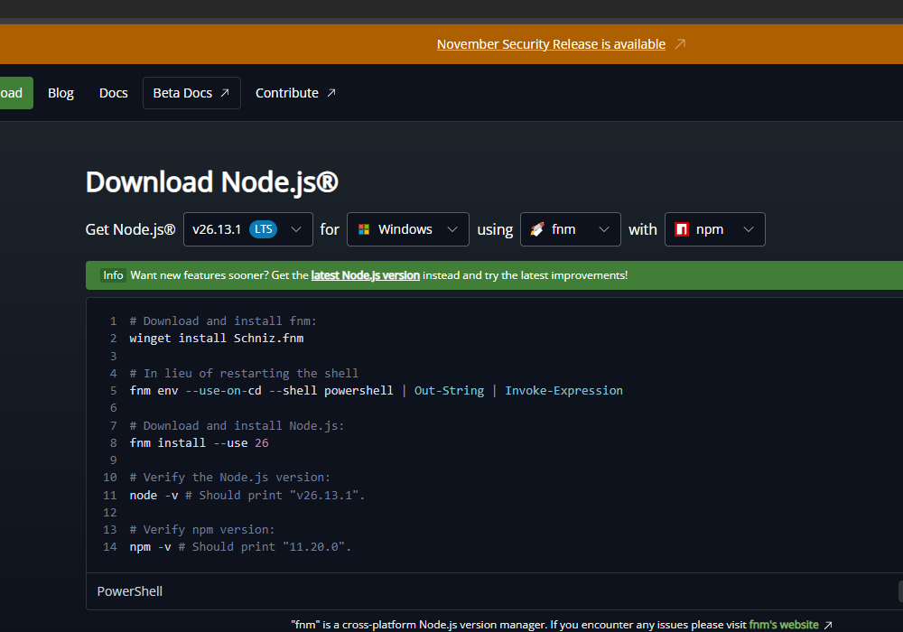</p>

| | |
|---|---|
| **Next** | 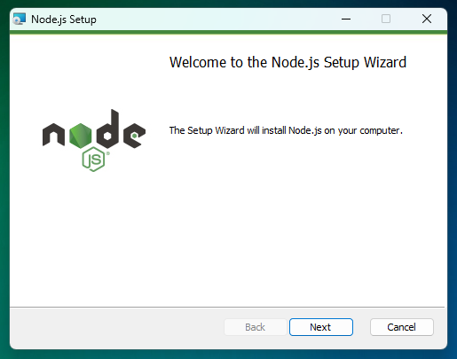 |
| **I accept the terms**, then **Next** | 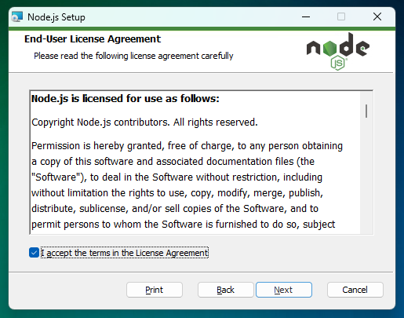 |
| **Next** | 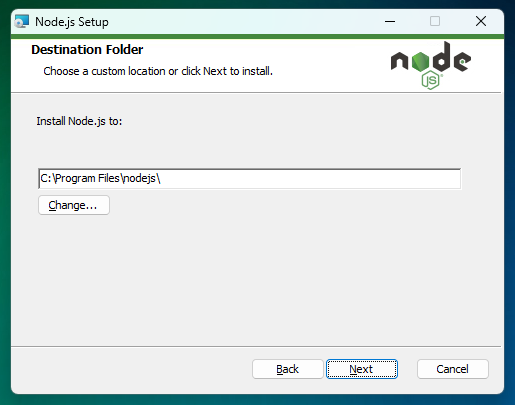 |
| **Next** | 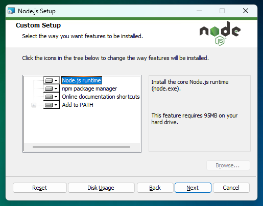 |
| Leave it unticked, then **Next** | 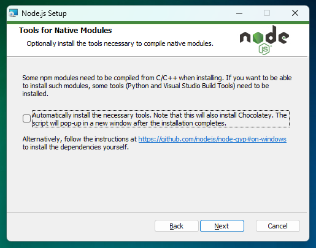 |
| **Install**. Windows asks *Do you want to allow this app to make changes to your device?*: **Yes** | 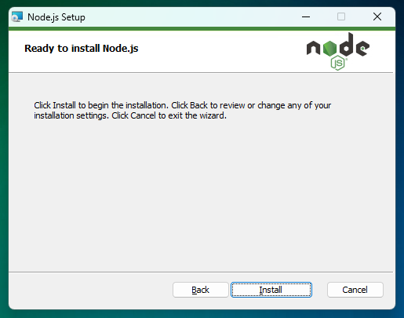 |
| **Finish** | 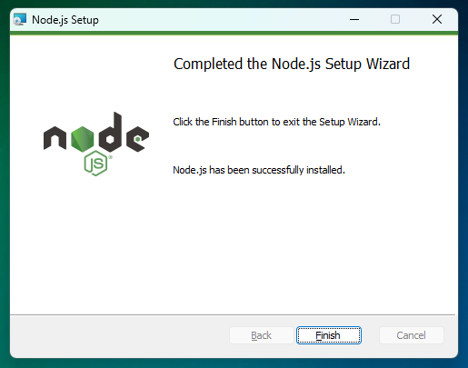 |

## 7. Install OpenCode

Chrysalis's **opencode** button, top right, shows the line to run:

<p align="center">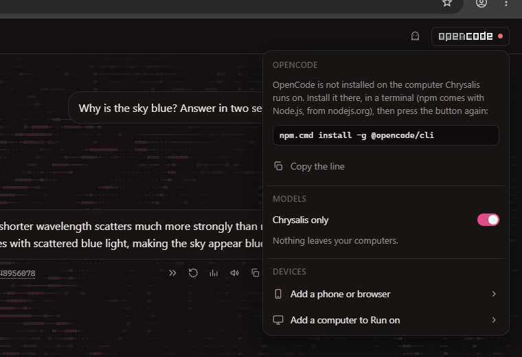</p>

Open a new **Terminal** (Start menu, Terminal) and paste:

```powershell
npm.cmd install -g @opencode/cli
```

<p align="center">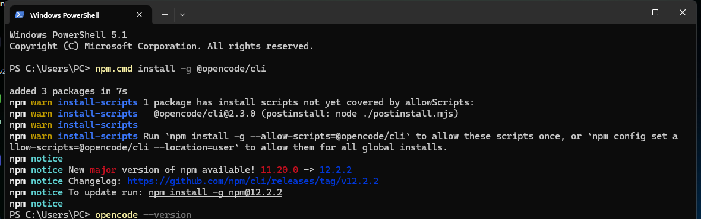</p>

The yellow warnings are normal. Check it:

```powershell
opencode.cmd --version
```

<p align="center">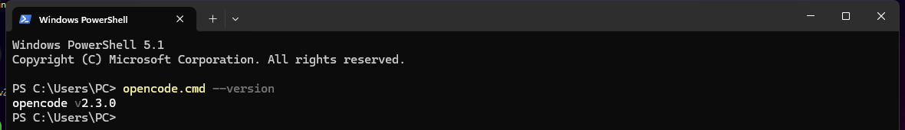</p>

Type `npm.cmd` and `opencode.cmd`, not `npm` and `opencode`: Windows 11's PowerShell refuses to run their `.ps1` scripts
until its execution policy is changed, and the `.cmd` ones need no change.

## 8. Connect

Press the **opencode** button again. Its dot turns green, and the message box shows the computer and folder OpenCode
works in.

<p align="center">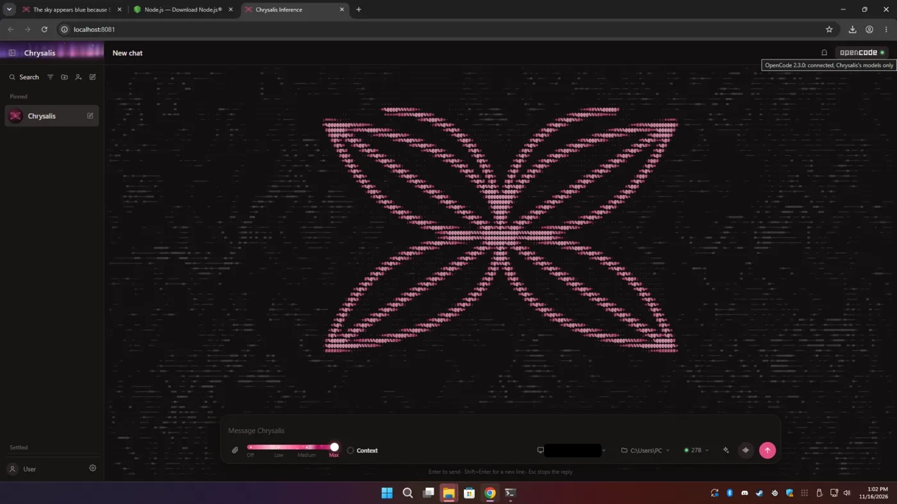</p>

Ask for something that needs a tool:

<p align="center">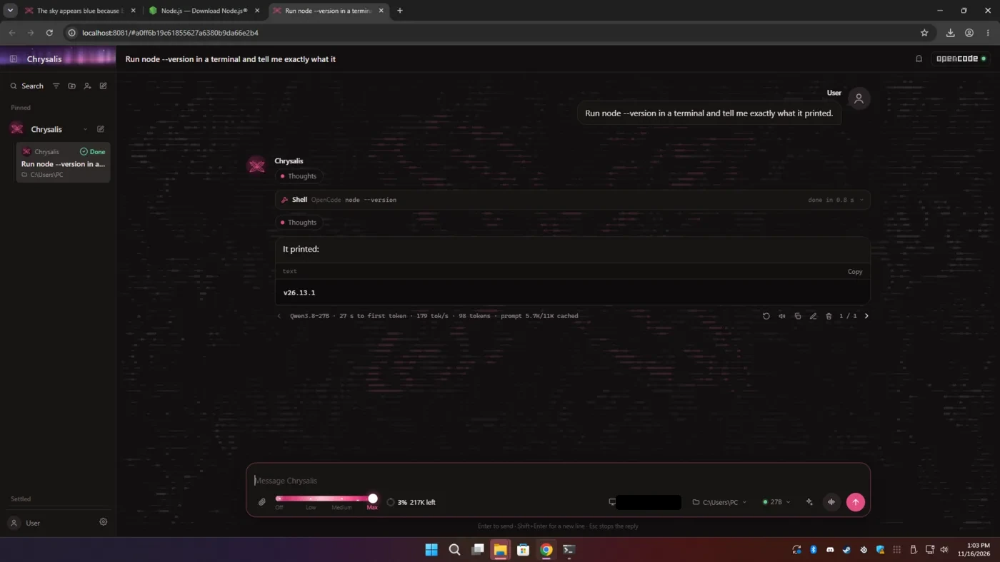</p>

## Removing it all

- Chrysalis, with its models and settings: the **Uninstall** row in its terminal, **Uninstall Chrysalis** in the Start
  menu, or the setup run again.
- OpenCode:

  ```powershell
  npm.cmd uninstall -g @opencode/cli
  ```

- Node.js: Settings, Apps, Installed apps, Node.js, Uninstall.
